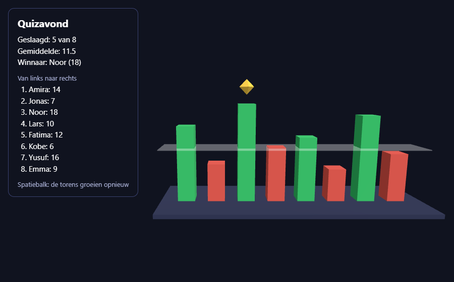
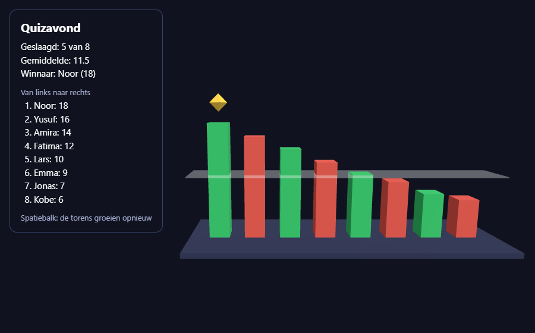

# Module 4: Code begrijpen, reviewen en verbeteren

In module 3 bouwde je zelf iets, en je zorgde dat je het kon uitleggen. Vaak begin je niet bij nul. Je neemt een project over dat iemand anders schreef: een collega, een vorige student, of een agent in een gesprek van vorige maand. Developers lezen veel meer code dan ze schrijven.

In deze module neem je zo'n project over. Je leert het kennen, je laat het reviewen, je beoordeelt de kwaliteit en je past het aan. Bij elke stap controleer je zelf of de uitleg, de review of de aanpassing van het model klopt.

### Leerdoelen

Na deze module kan je:

- een kaart maken van een bestaand project: welk bestand heeft welke taak, en welke bestanden gebruiken elkaar;
- gerichte uitleg vragen over een project, een function of een regel, en die uitleg testen;
- de control flow en de data flow van een function volgen, met een trace table;
- de aannames van een function opsporen;
- een review vragen op specifieke punten, en elke suggestie beoordelen in de context van je project;
- code beoordelen op leesbaarheid, structuur en onderhoudbaarheid;
- vooraf criteria vastleggen en daarmee een keuze tussen implementaties verantwoorden;
- een fout zonder foutmelding beschrijven met verwacht en werkelijk gedrag, en een voorgestelde oplossing beoordelen.

## 4.1 Een bestaand project leren kennen

Een collega bouwde een 3D-scorebord voor een quizavond, samen met een agent. Het grootste deel van de code is dus gegenereerd. Die collega werkt nu aan iets anders, en jij neemt het project over. Je hebt de code niet geschreven, en niemand legt ze je uit.

{width=560}

Elke speler is een toren. Hoe meer punten, hoe hoger de toren. Het project gebruikt three.js, net als je scène uit module 3.

Je kan het hele project aan een agent geven en vragen: "Leg uit wat dit doet." Dat gaat snel. Begin er toch niet mee. Wie eerst zelf kijkt, stelt daarna betere vragen, en kan de uitleg controleren.

### Kijk eerst zelf

Doe drie dingen, zonder AI:

1. Lees wat het project over zichzelf zegt. In `README.md` staat wat het project doet en hoe je het start. In `AGENTS.md` staan de afspraken (zie [2.4](./module-2.md#2_4)).
2. Start het project en kijk. Wat zie je, wat beweegt, en wat gebeurt er als je op de spatiebalk drukt?
3. Open elk bestand en lees de eerste regels. Je hoeft nog niet alles te begrijpen. Je zoekt per bestand één ding: wat is zijn taak?

Het scorebord is verdeeld over bestanden met elk één taak (zie [3.4](./module-3.md#3_4)). Bovenaan in `main.js` staat:

```js
import * as THREE from 'three';
import { players } from './data.js';
import { getScores, countPassed, calculateAverage, top } from './stats.js';
```

Met `export` deelt een bestand een function of een waarde. Met `import` haalt een ander bestand ze op. De regels met `import` bovenaan een bestand tonen dus welke andere bestanden het gebruikt. Hier lees je: `main.js` gebruikt de library three.js, de lijst `players` uit `data.js` en vier functions uit `stats.js`.

Zo maak je een **kaart** van het project: een overzicht van de bestanden, hun taak en wat ze van elkaar gebruiken.

| Bestand | Taak | Gebruikt |
| --- | --- | --- |
| `index.html` | de structuur van de pagina, met het paneel | `style.css`, `main.js` |
| `style.css` | de opmaak van het paneel | – |
| `data.js` | de scores van de spelers | – |
| `stats.js` | de berekeningen: hoeveel spelers geslaagd zijn, het gemiddelde en de winnaar | – |
| `main.js` | de 3D-scène, en de cijfers in het paneel | three.js, `data.js`, `stats.js` |

Er zijn ook drie hulpbestanden. Met `server.js` bekijk je de pagina (zie [3.4](./module-3.md#3_4)). `check.js` toont de berekeningen in de terminal. `package.json` vertelt Node.js dat de bestanden `import` en `export` gebruiken.

Met die kaart weet je waar je moet zoeken. Klopt een cijfer in het paneel niet? Dan kijk je in `stats.js` en in `main.js`, niet in `style.css`.

### De onderdelen van een three.js-scène

In module 3 werkte je met three.js zonder de library te kennen. Neem je een project over, dan wil je de grote onderdelen wel kunnen aanwijzen. Bijna elke three.js-scène heeft dezelfde zes onderdelen:

| Onderdeel | Wat het is | In `main.js` |
| --- | --- | --- |
| **scene** | de 3D-wereld. Wat je wil zien, voeg je toe met `scene.add()` | `const scene = new THREE.Scene();` |
| **camera** | het punt van waaruit je naar die wereld kijkt | `camera.position.set(-3, 5, 14);` |
| **renderer** | tekent op het scherm wat de camera ziet | `renderer.render(scene, camera);` |
| **mesh** | een voorwerp: een vorm (**geometry**) met een oppervlak (**material**) | `new THREE.Mesh(geometry, material)` |
| licht | zonder licht zijn de torens zwart (zie [3.2](./module-3.md#3_2)) | `new THREE.DirectionalLight(0xffffff, lightIntensity)` |
| animation loop | een function die telkens opnieuw uitgevoerd wordt, op de meeste schermen ongeveer zestig keer per seconde | `renderer.setAnimationLoop(animate);` |

Een toren in het scorebord is zo'n mesh: een doos met een kleur. Deze drie regels uit `createTower()` maken hem:

```js
const geometry = new THREE.BoxGeometry(towerWidth, 1, towerWidth);
const material = new THREE.MeshStandardMaterial({ color: color });
const tower = new THREE.Mesh(geometry, material);
```

Ken je die zes onderdelen, dan kan je in elke three.js-scène de weg vinden, ook in een scène die je zelf liet genereren.

### Vraag uitleg op drie niveaus

Nu heb je vragen. Stel ze gericht, en zeg dat de agent niets mag veranderen (zie [3.2](./module-3.md#3_2)). Je kan uitleg vragen op drie niveaus:

- Het project: hoe werken de bestanden samen?
- Eén function: wat krijgt ze, wat geeft ze terug, en waar wordt ze gebruikt?
- Eén regel of één getal: wat gebeurt er als je het verandert?

Een vraag over het project:

```text
Verander niets aan de code. Leg uit hoe de bestanden van dit project
samenwerken. Wat gebeurt er, in volgorde, vanaf het moment dat de browser
index.html laadt tot de torens op het scherm staan? Noem bij elke stap het
bestand en de function.
```

Een vraag over één function:

```text
Verander niets aan de code. Leg in eenvoudige woorden uit wat de function
animate in main.js doet. Waarom stopt een toren met groeien?
```

### Een uitleg is een interpretatie

De uitleg van een model is een interpretatie, geen garantie. Ze kan onvolledig zijn, een fout bevatten of net het belangrijkste weglaten. Controleer ze op twee manieren:

- Leg de uitleg naast je kaart. Noemt ze een bestand of een function die niet bestaat? Ontbreekt er een bestand?
- Test een bewering: voorspel, verander een waarde en kijk (zie [3.2](./module-3.md#3_2)).

Stel dat het model zegt: "`heightPerPoint` bepaalt hoe hoog een toren is per punt." Bovenaan in `main.js` staat `const heightPerPoint = 0.25;`. Voorspel: met 0.125 worden alle torens half zo hoog. Verander de waarde zelf en herlaad de pagina.

De torens zijn half zo hoog. Maar ook de witte lat hangt lager, en de gouden diamant boven de winnaar. De uitleg was juist, maar niet volledig: `heightPerPoint` wordt op drie plaatsen gebruikt. Dat zie je pas als je test.

Het doel is dat je het project begrijpt, niet dat je de uitleg kan herhalen.

Dit betekent voor jou: kan je aan een medestudent uitleggen hoe het project werkt, zonder de uitleg van het model erbij? Lukt dat niet, dan ben je er nog niet.

### Test jezelf 4.1 – Een bestaand project leren kennen {#test-jezelf-4-1-code-laten-uitleggen}

```text
Sectie: 4.1
Type: meerkeuze
Vraag: Je neemt een project over dat je niet zelf schreef. Wat doe je eerst? Kies één antwoord.
Opties:
  A. Je vraagt een agent om alle code uit te leggen, en je leest die uitleg.
  B. Je leest wat het project over zichzelf zegt, je start het en je zoekt per bestand wat zijn taak is.
  C. Je laat een agent de code herschrijven in een stijl die je beter kent.
  D. Je begint met de eerste wijziging: zo leer je de code vanzelf kennen.
Juist: B
Feedback A: Dat gaat snel, maar je kan de uitleg dan nergens mee vergelijken. Kijk eerst zelf (zie 4.1).
Feedback B: Juist. Zo maak je een kaart van het project, en kan je daarna gerichte vragen stellen (zie 4.1).
Feedback C: Dan heb je nieuwe code die je ook niet begrijpt, en je weet niet of ze nog hetzelfde doet (zie 4.1).
Feedback D: Wie iets verandert zonder het project te kennen, weet niet wat er nog van die code afhangt (zie 4.1).

Sectie: 4.1
Type: meerkeuze
Vraag: Bovenaan in main.js staat deze regel. Wat lees je eruit? Kies één antwoord.
Code:
  import { countPassed } from './stats.js';
Opties:
  A. main.js gebruikt de function countPassed, en die staat in stats.js.
  B. stats.js gebruikt een function uit main.js.
  C. De function countPassed wordt gekopieerd naar main.js en verdwijnt uit stats.js.
  D. main.js en stats.js zijn hetzelfde bestand.
Juist: A
Feedback A: Juist. De regels met `import` tonen welke andere bestanden een bestand gebruikt (zie 4.1).
Feedback B: Het is omgekeerd. Het bestand met de `import` gebruikt het andere bestand (zie 4.1).
Feedback C: De function blijft in stats.js staan. main.js mag ze gebruiken (zie 4.1).
Feedback D: Het zijn twee bestanden met elk een eigen taak (zie 4.1).

Sectie: 4.1
Type: koppelen
Vraag: Koppel elk onderdeel van een three.js-scène aan wat het is.
Paren:
  scene → de 3D-wereld waaraan je voorwerpen toevoegt
  camera → het punt van waaruit je kijkt
  renderer → tekent op het scherm wat de camera ziet
  mesh → een voorwerp: een vorm met een oppervlak
Feedback: Met deze onderdelen vind je de weg in elke three.js-scène (zie 4.1).

Sectie: 4.1
Type: meerkeuze
Vraag: Je wil weten hoe de bestanden van een project samenwerken. Welke prompt is het best? Kies één antwoord.
Opties:
  A. Leg de code uit.
  B. Is dit een goed project?
  C. Verander niets aan de code. Leg uit wat er in volgorde gebeurt vanaf het laden van index.html tot de torens op het scherm staan. Noem bij elke stap het bestand en de function.
  D. Maak het project duidelijker.
Juist: C
Feedback A: Je krijgt een lange tekst over alles. Een gerichte vraag geeft een antwoord dat je kan controleren (zie 4.1).
Feedback B: Dat is geen vraag om uitleg. En een model geeft je vaak gelijk (zie 1.5).
Feedback C: Juist. Je zegt wat niet mag, en je vraagt een volgorde met bestanden en functions. Dat kan je naast je kaart leggen (zie 4.1).
Feedback D: Dit is een vraag om aan te passen. De agent verandert je code (zie 2.5).

Sectie: 4.1
Type: meerkeuze
Vraag: Een agent legt uit hoe een onbekend project werkt. De uitleg klinkt logisch en volledig. Wat doe je nu? Kies één antwoord.
Opties:
  A. De uitleg aanvaarden en verdergaan: de agent heeft de code al gelezen.
  B. De uitleg naast je eigen kaart leggen, en één bewering testen.
  C. De agent in een tweede prompt vragen om de uitleg te bevestigen.
  D. Dezelfde vraag aan een tweede model stellen en het langste antwoord kiezen.
Juist: B
Feedback A: Een uitleg die logisch klinkt, kan toch onvolledig of fout zijn (zie 4.1).
Feedback B: Juist. De uitleg helpt je op weg, maar het begrip moet van jou komen (zie 4.1).
Feedback C: Een model bevestigt zijn eigen uitleg vaak zonder nieuwe controle (zie 1.5).
Feedback D: Een lang antwoord is niet juister dan een kort. Test een bewering in de code zelf (zie 4.1).

Sectie: 4.1
Type: juist/fout
Vraag: Als je de uitleg van een model over een project kan herhalen, begrijp je het project.
Juist: fout
Feedback: Herhalen is iets anders dan begrijpen. Je begrijpt het project als je kan voorspellen wat er gebeurt wanneer je iets verandert, en als je het in je eigen woorden kan uitleggen (zie 4.1).
```

## 4.2 Control flow, data flow en aannames

In het paneel van het scorebord staat: "Geslaagd: 5 van 8". Waar komt die 5 vandaan? "Ik denk dat het klopt" is geen analyse. Om code echt te begrijpen, volg je twee dingen: in welke volgorde ze uitgevoerd wordt, en wat er met de data gebeurt.

De 5 komt uit deze function in `stats.js`. Hier krijgt ze de scores van de eerste vier spelers:

```js
function countPassed(scores) {
  let passed = 0;
  for (const score of scores) {
    if (score >= 10) {
      passed++;
    }
  }
  return passed;
}

console.log(countPassed([14, 7, 18, 10]));
```

```output
3
```

De **control flow** (programmaverloop) is de volgorde waarin code uitgevoerd wordt. Hier wordt de loop vier keer uitgevoerd, en bij elke score beslist de `if` of `passed++` uitgevoerd wordt. Zonder de control flow weet je niet wat de code doet bij een bepaalde input.

De **data flow** (gegevensstroom) beschrijft hoe waarden door het programma bewegen en veranderen. Je volgt ze met een **trace table**: een tabel waarin je stap voor stap de waarden van de variables bijhoudt.

| Stap | score | score >= 10 | passed |
| --- | --- | --- | --- |
| start | – | – | 0 |
| 1 | 14 | true | 1 |
| 2 | 7 | false | 1 |
| 3 | 18 | true | 2 |
| 4 | 10 | true | 3 |

Kijk naar stap 4. Een score van precies 10 telt mee, want `10 >= 10` is waar. Zulke edge cases zie je in een trace table, en niet als je de code snel leest.

### De weg van de data door het project

Data beweegt ook van bestand naar bestand. De 5 in het paneel legde deze weg af:

1. In `data.js` staat de lijst `players`: acht spelers, elk met een naam en een score.
2. `getScores()` in `stats.js` maakt een nieuwe lijst met alleen de scores.
3. `countPassed()` in `stats.js` telt de scores van minstens 10, en geeft 5 terug.
4. `showStats()` in `main.js` zet de tekst "Geslaagd: 5 van 8" in het paneel.

In de code zijn dat deze twee regels uit `showStats()`:

```js
const scores = getScores(players);
document.getElementById('passed').textContent = 'Geslaagd: ' + countPassed(scores) + ' van ' + scores.length;
```

De eerste regel vraagt de lijst met scores. De tweede regel telt, en zet het resultaat in het paneel. Je kaart uit [4.1](#4_1) toont welke bestanden elkaar gebruiken. De data flow toont wat ze aan elkaar doorgeven.

Een model kan de control flow voor je beschrijven, of een trace table maken voor een bepaalde input. Dat is een goede hulp bij lange code. Controleer die tabel wel zelf: voer de code uit en vergelijk het resultaat.

### Aannames

Elke function maakt **aannames** over haar input: dingen die ze veronderstelt zonder ze te controleren. Bijvoorbeeld dat een lijst niet leeg is, dat een getal positief is of dat elke speler een score heeft. Kijk naar deze function uit `stats.js`:

```js
function calculateAverage(scores) {
  let sum = 0;
  for (const score of scores) {
    sum += score;
  }
  return sum / scores.length;
}

console.log(calculateAverage([14, 7, 18, 10]));
console.log(calculateAverage([]));
```

```output
12.25
NaN
```

De function neemt aan dat de lijst niet leeg is. Bij een lege lijst deelt ze 0 door 0, en dat geeft `NaN` (not a number).

Eén lege lijst heeft in dit project drie verschillende gevolgen:

| Aanroep | Resultaat | Is dat een probleem? |
| --- | --- | --- |
| `countPassed([])` | `0` | nee: in een lege lijst is niemand geslaagd |
| `calculateAverage([])` | `NaN` | ja: dat is geen bruikbaar gemiddelde |
| `top([])` | `undefined` | ja: `main.js` wil de score van de winnaar lezen, en de pagina crasht |

Staan er nog geen spelers in `data.js`, dan blijft het beeld leeg, en in het paneel staan geen cijfers. In de console van de browser staat:

```output
Uncaught TypeError: Cannot read properties of undefined (reading 'score')
```

Niet elke edge case is dus een probleem, maar je weet het pas als je hem volgt. Een model maakt zulke aannames soms zichtbaar, maar niet altijd allemaal. Zoek er zelf actief naar. Stel bij elke function deze vragen:

- Wat als de lijst leeg is?
- Wat als een waarde ontbreekt?
- Wat als een getal buiten de grenzen valt, zoals een score van 25 of van -3?

Dit betekent voor jou: volg bij code die je overneemt ook de input die niemand verwachtte.

### Test jezelf 4.2 – Control flow, data flow en aannames {#test-jezelf-4-2-control-flow-data-flow-en-aannames}

```text
Sectie: 4.2
Type: meerkeuze
Vraag: Wat beschrijft de data flow van een programma? Kies één antwoord.
Opties:
  A. De volgorde waarin code uitgevoerd wordt.
  B. De mappenstructuur van een project.
  C. De manier waarop je een project start.
  D. Hoe waarden door het programma bewegen en veranderen.
Juist: D
Feedback A: Dat is de control flow (zie 4.2).
Feedback B: De mappenstructuur gaat over de plaats van bestanden, niet over data (zie 4.2).
Feedback C: Dat staat in de README van het project. Het zegt niets over de data (zie 4.1).
Feedback D: Juist. Met een trace table volg je de data flow stap voor stap (zie 4.2).

Sectie: 4.2
Type: numeriek
Vraag: Wat geeft deze aanroep terug?
Code:
  function countPassed(scores) {
    let passed = 0;
    for (const score of scores) {
      if (score >= 10) {
        passed++;
      }
    }
    return passed;
  }
  countPassed([9, 10, 15, 4]);
Juist: 2
Feedback: Alleen 10 en 15 zijn groter dan of gelijk aan 10. Maak een trace table als je twijfelt (zie 4.2).

Sectie: 4.2
Type: numeriek
Vraag: Wat geeft countPassed([]) terug, met de function uit 4.2?
Juist: 0
Feedback: De loop wordt nul keer uitgevoerd, dus `passed` blijft 0. Dat is hier ook het juiste antwoord: niet elke edge case is een probleem (zie 4.2).

Sectie: 4.2
Type: meerkeuze
Vraag: Welke aanname maakt `calculateAverage` uit 4.2 over haar input? Kies één antwoord.
Opties:
  A. Dat de lijst niet leeg is.
  B. Dat de lijst gesorteerd is.
  C. Dat alle getallen groter zijn dan 10.
  D. Dat de lijst minstens drie getallen bevat.
Juist: A
Feedback A: Juist. Bij een lege lijst deelt de function 0 door 0, met `NaN` als resultaat (zie 4.2).
Feedback B: De volgorde maakt niet uit voor een som of een gemiddelde (zie 4.2).
Feedback C: Ook kleine getallen geven een juist gemiddelde (zie 4.2).
Feedback D: Ook met één of twee getallen werkt de function juist. Alleen nul getallen is een probleem (zie 4.2).

Sectie: 4.2
Type: ordenen
Vraag: In het paneel van het scorebord staat "Geslaagd: 5 van 8". Zet de weg van de data in de juiste volgorde.
Volgorde:
  In data.js staat de lijst met de spelers en hun scores.
  getScores in stats.js maakt een nieuwe lijst met alleen de scores.
  countPassed in stats.js telt de scores van minstens 10.
  main.js zet de tekst met het resultaat in het paneel.
Feedback: De data begint in data.js, gaat door twee functions in stats.js, en komt via main.js op het scherm (zie 4.2).

Sectie: 4.2
Type: meerkeuze
Vraag: Een model maakt voor jou een trace table van een function. Wat doe je ermee? Kies één antwoord.
Opties:
  A. Je neemt ze over: een trace table is een berekening, en een model rekent zonder fouten.
  B. Je vraagt het model of de tabel zeker klopt.
  C. Je voert de code uit met dezelfde input en vergelijkt het resultaat met de tabel.
  D. Je gebruikt ze niet: een model kan geen trace table maken.
Juist: C
Feedback A: Een model voorspelt tekst. Het is geen rekenmachine, dus ook een trace table van een model kan een fout bevatten (zie 1.2).
Feedback B: Een model geeft je vaak gelijk. Dat is geen controle (zie 1.5).
Feedback C: Juist. De code uitvoeren geeft zekerheid over het resultaat (zie 4.2).
Feedback D: Een model kan dat wel, en het is een goede hulp bij lange code. Je controleert de tabel wel zelf (zie 4.2).
```

## 4.3 Een agent als eerste code reviewer

In een professioneel team gaat code eerst door een **code review** (codebeoordeling) voor ze bij de rest komt. Een of meer collega's lezen je code, geven feedback en wijzen op problemen die je zelf niet zag. Dat is waardevol, maar het kost tijd.

Een agent kan een eerste reviewronde doen. Niet als vervanging van een collega, maar om de duidelijkste problemen eruit te halen voor iemand anders de code leest. Neem je een project over, dan is zo'n review ook een snelle manier om te zien waar de zwakke plekken zitten.

### Vraag een review op specifieke punten

Op "Is deze code goed?" krijg je een algemeen antwoord. Zeg op welke punten je een review wil:

- Leesbaarheid: zijn de namen duidelijk, is de code consistent?
- Logica: klopt de code voor alle input, ook voor edge cases?
- Foutafhandeling: wat gebeurt er als iets misloopt?
- Afspraken: volgt de code de afspraken van het project?

Een review is een vraag van de soort evalueren (zie [2.5](./module-2.md#2_5)). Zeg dus dat de agent niets mag veranderen. Vraag ook een vaste vorm, zodat je elke opmerking kan terugvinden in de code:

```text
Verander niets aan de code. Review stats.js op leesbaarheid, edge cases en
de afspraken in AGENTS.md. Geef per opmerking de regel, het probleem en een
voorstel.
```

### Suggesties zijn geen beslissingen

De output van een review zijn suggesties. Het model weet alleen wat in zijn context staat (zie [1.4](./module-1.md#1_4)). Het weet niet waarom een keuze gemaakt werd, of wat er met de klant afgesproken is. Beoordeel daarom elke suggestie met drie vragen:

1. Klopt het probleem? Test het in de code.
2. Past het voorstel in dit project? Leg het naast de afspraken.
3. Wordt de code er beter van?

Stel dat de review van `stats.js` deze vier opmerkingen geeft:

| Suggestie | Klopt het probleem? | Past het voorstel? | Beslissing |
| --- | --- | --- | --- |
| De namen `top`, `a` en `x` zeggen niet wat ze zijn. Geef ze duidelijke namen. | ja, dat zie je in de code | ja | overnemen |
| `calculateAverage` geeft `NaN` bij een lege lijst. Gooi een Error. | ja, getest in [4.2](#4_2) | nee: volgens `AGENTS.md` geeft een function dan `null` terug, en gooit ze geen fout | het probleem oplossen, op de manier van het project |
| Herschrijf het project in TypeScript (een strengere variant van JavaScript). Dat geeft meer zekerheid. | het is geen fout in de code, maar een algemeen advies | nee: volgens `AGENTS.md` gebruikt het project geen TypeScript | verwerpen |
| De loop in `top` begint bij 1 en slaat de eerste speler over. Begin bij 0. | nee: de eerste speler is de beginwaarde. Test het met een lijst waarin de eerste speler wint | – | verwerpen |

De vier opmerkingen klinken even zeker. Toch neem je er maar één volledig over. De tweede heeft een echt probleem met een voorstel dat niet past. De derde is een algemeen advies dat tegen een afspraak ingaat. De vierde is gewoon fout: een review kan ook een probleem melden dat er niet is.

De laatste suggestie test je zo:

```js
const players = [
  { name: 'Noor', score: 18 },
  { name: 'Jonas', score: 7 },
];

console.log(top(players).name);
```

```output
Noor
```

De eerste speler wint, en `top` vindt hem. De loop slaat hem dus niet over.

Begrijp je een opmerking niet? Dan kan je ze ook niet beoordelen. Vraag eerst uitleg over die ene opmerking, in eenvoudige woorden en zonder wijziging (zie [4.1](#4_1)). "Dat weet ik nog niet" is een eerlijker antwoord dan "overnemen".

Een review vindt ook niet alles. "Geen opmerkingen" betekent niet dat de code geen fouten bevat. In [4.6](#4_6) zie je een fout in het scorebord die een review van `stats.js` niet kan vinden: ze zit in het verschil tussen twee bestanden.

Dit betekent voor jou: een review geeft je een extra paar ogen. De beslissing blijft bij jou.

### Test jezelf 4.3 – Een agent als eerste code reviewer {#test-jezelf-4-3-ai-als-eerste-code-reviewer}

```text
Sectie: 4.3
Type: meerkeuze
Vraag: Welke prompt geeft de bruikbaarste review? Kies één antwoord.
Opties:
  A. Is deze code goed?
  B. Verbeter stats.js.
  C. Verander niets aan de code. Review stats.js op leesbaarheid, edge cases en de afspraken in AGENTS.md. Geef per opmerking de regel, het probleem en een voorstel.
  D. Review alles en pas aan wat je vindt.
Juist: C
Feedback A: Je krijgt een algemeen antwoord. Zeg op welke punten je een review wil (zie 4.3).
Feedback B: Dit is een vraag om aan te passen. De agent verandert je code, en jij beoordeelde nog niets (zie 2.5).
Feedback C: Juist. Je zegt wat niet mag, op welke punten je een review wil en in welke vorm (zie 4.3).
Feedback D: Dan beslist de agent wat er verandert. Suggesties zijn geen beslissingen (zie 4.3).

Sectie: 4.3
Type: meerkeuze
Vraag: Een review geeft vijf suggesties. Eén ervan stelt een naam voor die in jouw project minder duidelijk is. Wat doe je? Kies één antwoord.
Opties:
  A. De suggestie overnemen: het model weet meer over goede namen.
  B. Alle suggesties overnemen, voor een consistente aanpak.
  C. De suggestie afwegen tegen je project, en ze verwerpen als de code er niet beter van wordt.
  D. De review opnieuw laten doen tot die suggestie verdwijnt.
Juist: C
Feedback A: Het model weet alleen wat in zijn context staat. Een algemene regel is niet altijd beter in jouw project (zie 4.3).
Feedback B: Suggesties zijn geen beslissingen. Je beoordeelt ze één voor één (zie 4.3).
Feedback C: Juist. Jij kent het project, dus jij beslist (zie 4.3).
Feedback D: Dat kost prompts en lost niets op. De beoordeling blijft jouw taak (zie 4.3).

Sectie: 4.3
Type: meerkeuze
Vraag: Een review zegt: "De loop in top begint bij 1 en slaat de eerste speler over." Hoe controleer je dat het best? Kies één antwoord.
Opties:
  A. Je voert top uit met een lijst waarin de eerste speler de hoogste score heeft.
  B. Je past de loop aan zoals de review voorstelt.
  C. Je vraagt de agent of hij zeker is.
  D. Je controleert niets: een review vindt alleen echte problemen.
Juist: A
Feedback A: Juist. Geeft de function de eerste speler terug, dan klopt de opmerking niet (zie 4.3).
Feedback B: Dan verander je code op basis van een opmerking die je niet controleerde (zie 4.3).
Feedback C: Een model geeft je vaak gelijk, of blijft bij zijn antwoord. Dat is geen test (zie 1.5).
Feedback D: Een review kan ook een probleem melden dat er niet is (zie 4.3).

Sectie: 4.3
Type: categoriseren
Vraag: De afspraken van een project zeggen: geen TypeScript, geen extra libraries, en een function geeft null terug als ze niets kan berekenen. Welke suggesties uit een review passen in dit project?
Indeling:
  Geef de variable x de naam winner. → past in het project
  Geef null terug bij een lege lijst. → past in het project
  Herschrijf de code in TypeScript. → past niet in het project
  Installeer een library om het gemiddelde te berekenen. → past niet in het project
  Gooi een Error bij een lege lijst. → past niet in het project
Feedback: Een suggestie kan goed klinken en toch tegen een afspraak ingaan. Leg elk voorstel naast de afspraken van je project (zie 4.3).

Sectie: 4.3
Type: meerkeuze
Vraag: Waarvoor is een review door een agent het nuttigst? Kies één antwoord.
Opties:
  A. Onduidelijke namen, edge cases die niet afgehandeld worden en afspraken die niet gevolgd zijn.
  B. Beslissen of de klant tevreden zal zijn met het project.
  C. Bewijzen dat de code geen fouten bevat.
  D. Beoordelen of de communicatie in het team goed verliep.
Juist: A
Feedback A: Juist. Dat zijn problemen die je in de code en in de afspraken zelf kan zien (zie 4.3).
Feedback B: Wat de klant wil, staat niet in de code. Het model kan dat niet weten (zie 4.3).
Feedback C: Een review vindt niet alles. Geen opmerkingen is geen bewijs (zie 4.3).
Feedback D: Dat staat niet in de code, dus een review van code kan het niet beoordelen (zie 4.3).

Sectie: 4.3
Type: juist/fout
Vraag: Een review zonder opmerkingen bewijst dat de code geen fouten bevat.
Juist: fout
Feedback: Een review vindt niet alles. Sommige fouten zie je alleen als je de code uitvoert, of als je twee bestanden naast elkaar legt (zie 4.3).
```

## 4.4 Codekwaliteit: meer dan werkende code

Twee versies van dezelfde function. Beide zoeken de speler met de hoogste score.

```js
// Versie A: zo staat ze in stats.js
function top(a) {
  let x = a[0];
  for (let i = 1; i < a.length; i++) {
    if (a[i].score > x.score) {
      x = a[i];
    }
  }
  return x;
}

// Versie B
function findWinner(players) {
  let winner = players[0];
  for (const player of players) {
    if (player.score > winner.score) {
      winner = player;
    }
  }
  return winner;
}
```

Beide geven voor het scorebord dezelfde winnaar:

```output
Noor
```

Toch wil je in je project versie B. "De code werkt" is geen kwaliteitscriterium, het is het minimum. Om code te beoordelen, heb je criteria nodig. Deze drie gebruik je altijd:

- **Leesbaarheid.** Code wordt vaker gelezen dan geschreven: door jezelf over drie maanden, door een collega, of door wie het project overneemt. Leesbare code heeft namen die zeggen wat iets is of doet, en volgt overal dezelfde conventies. In versie A moet je de hele function lezen om te weten wat `a` en `x` zijn. In versie B zeggen de namen het.
- **Structuur.** Een function doet één ding, en elk bestand heeft één taak (zie [3.4](./module-3.md#3_4)). In het scorebord maakt `createFloor()` de vloer en `createTower()` een toren. Een function van honderd regels die vijf dingen doet, is slecht gestructureerd, ook als ze juist werkt.
- **Onderhoudbaarheid.** Requirements veranderen, dus code ook. Goede code pas je op één plaats aan. Moet je voor één kleine wijziging op veel plaatsen zijn, dan is de onderhoudbaarheid laag.

Het scorebord heeft een voorbeeld van dat laatste. De regel "geslaagd met minstens 10 punten" staat op drie plaatsen in de code:

```js
// stats.js, in countPassed()
if (score >= 10) {

// main.js, in createTower()
if (player.score > 10) {

// main.js, in createPassLine()
passLine.position.y = 10 * heightPerPoint;
```

Wordt de grens volgende maand 12 punten? Dan moet je de drie plaatsen kennen, en mag je er geen vergeten. Vergelijk dat met `heightPerPoint` uit [4.1](#4_1): die waarde staat op één plaats, en elke regel die ze nodig heeft, gebruikt de naam.

### Beter, of alleen anders?

Vraag je een agent om code te verbeteren, dan krijg je bijna altijd iets terug. Toets het aan je criteria. Is de code leesbaarder geworden? Is de structuur duidelijker? Pas je ze nu op minder plaatsen aan? Of is ze alleen anders?

Anders is niet hetzelfde als beter.

Een verbetering vragen is een vraag van de soort aanpassen (zie [2.5](./module-2.md#2_5)): zeg wat verandert, en wat hetzelfde blijft. Kies de plaats en de naam zelf. Zeg je ze niet, dan kiest het model (zie [2.1](./module-2.md#2_1)).

```text
De grens van 10 punten staat op drie plaatsen in de code. Geef ze één
plaats: maak in stats.js een const passMark = 10, en gebruik die naam op
de drie plaatsen. Het gedrag blijft precies hetzelfde. Verander niets
anders.
```

De drie plaatsen zocht je vooraf zelf op. Zo weet je waar er iets moet veranderen, en kan je achteraf controleren of het daar gebeurde.

Controleer na de wijziging drie dingen:

- Doet de code nog hetzelfde? Typ voor en na de wijziging `node check.js` in de terminal, en vergelijk de output. Bekijk ook de pagina.
- Veranderde er iets wat je niet vroeg (zie [1.5](./module-1.md#1_5))?
- Is de code beter volgens je criteria, of alleen anders?

De structuur van code verbeteren zonder het gedrag te veranderen, heet refactoring. In module 5 leer je dat in kleine stappen doen.

### Test jezelf 4.4 – Codekwaliteit {#test-jezelf-4-4-codekwaliteit}

```text
Sectie: 4.4
Type: meerkeuze
Vraag: Een model stelt voor om de function `processData` te hernoemen naar `pd`, "voor betere leesbaarheid". Wat is je oordeel? Kies één antwoord.
Opties:
  A. Aanvaarden: kortere namen zijn efficiënter.
  B. Aanvaarden als de rest van de codebase ook afkortingen gebruikt.
  C. Verwerpen: de kortere naam maakt de code minder leesbaar.
  D. Het model vragen om een derde naam.
Juist: C
Feedback A: Een kortere naam maakt de code niet sneller, wel moeilijker te lezen (zie 4.4).
Feedback B: Ook dan zegt `pd` niets over wat de function doet. Consistentie maakt een onduidelijke naam niet duidelijk (zie 4.4).
Feedback C: Juist. Een goede naam zegt wat iets is of doet (zie 4.4).
Feedback D: Dat kan, maar eerst stel je vast dat dit voorstel slechter is (zie 4.4).

Sectie: 4.4
Type: meerkeuze
Vraag: Waarom scoort versie B uit 4.4 (`findWinner`) beter dan versie A (`top`)? Kies één antwoord.
Opties:
  A. Versie B is sneller.
  B. Versie B geeft een andere, juistere winnaar.
  C. Versie A is fout, omdat een loop niet bij 1 mag beginnen.
  D. Versie B heeft namen die zeggen wat de code doet.
Juist: D
Feedback A: Voor acht spelers is er geen verschil in snelheid. Het verschil zit in de leesbaarheid (zie 4.4).
Feedback B: Beide versies geven dezelfde winnaar (zie 4.4).
Feedback C: Versie A werkt juist. De eerste speler is de beginwaarde (zie 4.3).
Feedback D: Juist. Wie versie B leest, weet meteen wat `players` en `winner` zijn (zie 4.4).

Sectie: 4.4
Type: koppelen
Vraag: Koppel elk probleem aan het kwaliteitscriterium waar het over gaat.
Paren:
  Een variable heet `x` in plaats van `winner`. → leesbaarheid
  Eén function leest een bestand, controleert de data en verstuurt een e-mail. → structuur
  Een nieuwe regel voor de quiz vraagt aanpassingen op drie plaatsen in de code. → onderhoudbaarheid
Feedback: Leesbaarheid gaat over namen en conventies, structuur over wie welke taak heeft, onderhoudbaarheid over hoe makkelijk code verandert (zie 4.4).

Sectie: 4.4
Type: meerkeuze
Vraag: Je liet een agent de function top hernoemen naar findWinner. Hoe controleer je of de code nog hetzelfde doet? Kies één antwoord.
Opties:
  A. Je leest het antwoord van de agent: daar staat dat het gedrag hetzelfde bleef.
  B. Je vergelijkt de output van `node check.js` van voor en na de wijziging, en je bekijkt de pagina.
  C. Je controleert alleen of er geen foutmelding verschijnt.
  D. Je vraagt de agent om de wijziging nog eens te doen.
Juist: B
Feedback A: Dat is een bewering van het model, geen controle (zie 1.7).
Feedback B: Juist. Dezelfde input moet dezelfde output geven, voor en na (zie 4.4).
Feedback C: Code kan zonder foutmelding uitvoeren en toch een ander resultaat geven (zie 3.5).
Feedback D: Dat is geen controle, en het kost een prompt (zie 4.4).

Sectie: 4.4
Type: meerkeuze
Vraag: Een agent "verbeterde" een function. De namen en de volgorde van de regels zijn veranderd, maar de code is niet makkelijker te lezen of aan te passen. Wat is je conclusie? Kies één antwoord.
Opties:
  A. De code is beter: ze is nieuwer.
  B. De code is beter: een agent verandert alleen wat nodig is.
  C. De code is alleen anders. Je neemt de wijziging niet over.
  D. De code is slechter: gegenereerde code is altijd slechter dan eigen code.
Juist: C
Feedback A: Nieuwer is geen criterium. Toets aan leesbaarheid, structuur en onderhoudbaarheid (zie 4.4).
Feedback B: Een agent levert bijna altijd iets, ook als er niets te verbeteren viel (zie 4.4).
Feedback C: Juist. Anders is niet hetzelfde als beter (zie 4.4).
Feedback D: Dat is een vooroordeel, geen beoordeling. Je toetst elke versie aan je criteria (zie 4.4).
```

## 4.5 Afwegingen tussen implementaties

Je vraagt een agent om een nieuwe versie van `findWinner`, en je krijgt er twee:

```js
// Versie A
function findWinnerA(players) {
  if (players.length === 0) {
    return null;
  }
  let winner = players[0];
  for (const player of players) {
    if (player.score > winner.score) {
      winner = player;
    }
  }
  return winner;
}

// Versie B
function findWinnerB(players) {
  players.sort((a, b) => b.score - a.score);
  return players[0];
}
```

Versie A kan je lezen: een loop en `if`. Versie B is veel korter. Ze gebruikt `sort`: dat zet een lijst in een andere volgorde, hier met de hoogste score eerst. Daarna geeft ze de eerste speler terug.

Misschien kan je de regel met `sort` niet zelf schrijven. Bij gegenereerde code gebeurt dat vaak, en het is geen probleem. Je moet wel weten wat de regel doet. Vraag dus uitleg (zie [4.1](#4_1)), en test wat je hoort.

Welke is de juiste? Dat is zelden een vraag met één antwoord. Het hangt af van de context: hoe groot is de lijst, wie moet de code lezen, en wat zeggen de afspraken van het project?

Een model genereert snel meerdere implementaties: verschillende manieren om hetzelfde probleem op te lossen. Dat is waardevol: niet om de eerste te kiezen, maar om de afweging te kunnen maken.

### Eerst je criteria, dan de code

Leg je criteria vast voor je de oplossingen bekijkt. Bedenk je ze pas achteraf, dan kies je ongemerkt de oplossing die er het slimst uitziet, en zoek je daar redenen bij. Typische criteria zijn:

- Leesbaarheid: begrijpt een developer in dit team de code zonder uitleg?
- Efficiëntie: hoeveel tijd en geheugen gebruikt de code, en is dat belangrijk voor dit gebruik?
- Integratie: past de oplossing bij de afspraken en de bestaande code van het project?
- Uitbreidbaarheid: kan je de oplossing makkelijk aanpassen als de requirements veranderen?
- Testbaarheid: kan je de code apart testen?

Voor het scorebord tellen er twee het zwaarst. Leesbaarheid, want jij en je collega's moeten de code kunnen lezen. En integratie, want in `AGENTS.md` staan twee afspraken die hier tellen: een function in `stats.js` verandert haar input niet, en bij een lege lijst geeft ze `null` terug. Efficiëntie telt hier bijna niet: de lijst heeft acht spelers.

### Vergelijk met feiten

Lezen alleen is niet genoeg. Voer de twee versies uit met dezelfde lijst (Amira, Jonas, Noor en Lars) en met een lege lijst:

```output
Versie A
  Winnaar van de lijst:    Noor
  Volgorde van de lijst:   Amira, Jonas, Noor, Lars
  Winnaar van lege lijst:  null
Versie B
  Winnaar van de lijst:    Noor
  Volgorde van de lijst:   Noor, Amira, Lars, Jonas
  Winnaar van lege lijst:  undefined
```

Beide vinden Noor. De verschillen zitten ergens anders:

| Criterium | Versie A | Versie B |
| --- | --- | --- |
| Leesbaarheid | een loop en `if`: iedereen in het team kan het volgen | kort, maar je moet weten wat `sort` met de lijst doet |
| Integratie: verandert de input niet | in orde | niet in orde: de lijst staat daarna in een andere volgorde |
| Integratie: `null` bij een lege lijst | in orde | niet in orde: `undefined` |

Versie B is de kortste, en net die is gevaarlijk. `sort` sorteert de lijst zelf, en elk ander deel van het project dat `players` gebruikt, krijgt nu een andere volgorde. Zet je versie B in het scorebord, dan krijgen de torens de hoogte van een andere speler:

{width=560}

De pagina toont geen foutmelding, en `findWinnerB` geeft de juiste winnaar. Wie alleen kijkt naar wat de function teruggeeft, ziet dit niet.

### Verantwoord je keuze

Na je keuze moet je ze kunnen verantwoorden. Dus niet: "Deze leek me de beste." Wel: "Ik kies versie A. Ze volgt de twee afspraken van het project, en iedereen in het team kan ze lezen. Dat ze een paar regels langer is, weegt daar niet tegen op."

Dat is het verschil tussen een beslissing en een voorkeur.

### Test jezelf 4.5 – Afwegingen tussen implementaties {#test-jezelf-4-5-afwegingen-tussen-implementaties}

```text
Sectie: 4.5
Type: meerkeuze
Vraag: Waarom leg je je criteria vast voor je de gegenereerde versies bekijkt? Kies één antwoord.
Opties:
  A. Anders weet het model niet op welke criteria het moet letten.
  B. Zo vermijd je dat je ongemerkt de versie kiest die er het slimst uitziet.
  C. Criteria achteraf vastleggen is in een bedrijf verboden.
  D. Het model past de criteria dan vanzelf toe.
Juist: B
Feedback A: Het gaat om jouw beoordeling, niet om wat het model doet (zie 4.5).
Feedback B: Juist. Met criteria vooraf kies je met redenen, en niet op gevoel (zie 4.5).
Feedback C: Het is geen regel, maar een manier om eerlijk te beoordelen (zie 4.5).
Feedback D: Ook als je criteria meegeeft, beoordeel jij de output (zie 4.5).

Sectie: 4.5
Type: meerkeuze
Vraag: Je laat een paar implementaties voor hetzelfde probleem genereren. Welke aanpak is het best? Kies één antwoord.
Opties:
  A. De kortste versie kiezen: minder code betekent minder fouten.
  B. De eerste versie kiezen: het model geeft de beste oplossing eerst.
  C. De versie kiezen die het meest lijkt op voorbeelden die je online vond.
  D. Elke versie toetsen aan criteria die je vooraf vastlegde, en je keuze verantwoorden.
Juist: D
Feedback A: Korter is niet altijd leesbaarder of juister. Versie B uit 4.5 is kort, en verandert de lijst (zie 4.5).
Feedback B: De volgorde van de output zegt niets over de kwaliteit (zie 4.5).
Feedback C: Gelijkenis met online code zegt niets over hoe goed ze bij jouw project past (zie 4.5).
Feedback D: Juist. Zo wordt je keuze een beslissing in plaats van een voorkeur (zie 4.5).

Sectie: 4.5
Type: meerkeuze
Vraag: Versie B uit 4.5 sorteert de lijst players zelf. Volgens de afspraken van het project verandert een function in stats.js haar input niet. Op welk criterium scoort versie B slecht? Kies één antwoord.
Opties:
  A. Efficiëntie.
  B. Integratie.
  C. Testbaarheid.
  D. Op geen enkel: versie B geeft de juiste winnaar.
Juist: B
Feedback A: Voor acht spelers is sorteren snel genoeg. Het probleem is wat er met de lijst gebeurt (zie 4.5).
Feedback B: Juist. De versie past niet bij de afspraken en bij de rest van het project, dat de lijst in de oorspronkelijke volgorde verwacht (zie 4.5).
Feedback C: Je kan de function apart testen. Het probleem zie je net niet als je alleen kijkt naar wat ze teruggeeft (zie 4.5).
Feedback D: De winnaar klopt, maar de torens krijgen daarna de hoogte van een andere speler (zie 4.5).

Sectie: 4.5
Type: meerkeuze
Vraag: Het scorebord toont acht spelers. Welk criterium weegt in dit project het minst? Kies één antwoord.
Opties:
  A. Leesbaarheid.
  B. Integratie.
  C. Efficiëntie.
  D. Ze wegen altijd allemaal even zwaar.
Juist: C
Feedback A: Jij en je collega's moeten de code kunnen lezen. Dat blijft belangrijk (zie 4.5).
Feedback B: De code moet de afspraken van het project volgen. Dat blijft belangrijk (zie 4.5).
Feedback C: Juist. Bij acht spelers merk je geen verschil in snelheid. Bij een miljoen spelers zou dat anders zijn (zie 4.5).
Feedback D: Hoe zwaar een criterium weegt, hangt af van de context (zie 4.5).

Sectie: 4.5
Type: meerkeuze
Vraag: Welke zin verantwoordt een keuze het best? Kies één antwoord.
Opties:
  A. Deze versie leek me de beste.
  B. Deze versie is de kortste.
  C. Het model raadde deze versie aan.
  D. Deze versie volgt de afspraken van het project en is voor het team het makkelijkst te lezen. Dat ze een paar regels langer is, weegt daar niet tegen op.
Juist: D
Feedback A: Dat is een voorkeur, geen beslissing. Je zegt niet waarom (zie 4.5).
Feedback B: Kort is geen criterium op zich. Je zegt niet waarom dat hier belangrijk is (zie 4.5).
Feedback C: Jij bent verantwoordelijk voor de keuze, niet het model (zie 1.6).
Feedback D: Juist. Je noemt je criteria, en je zegt wat hier minder zwaar weegt (zie 4.5).
```

## 4.6 Een fout aanpakken met een agent

Kijk nog eens naar het scorebord uit [4.1](#4_1). In het paneel staat "Geslaagd: 5 van 8". Tel nu de groene torens: het zijn er vier.

Er is geen foutmelding, en de console is leeg. De pagina werkt, maar ze klopt niet. Zulke fouten vind je alleen als je kritisch kijkt (zie [3.5](./module-3.md#3_5)).

Een agent kan helpen bij het zoeken naar de oorzaak. Jouw aanpak bepaalt of je het probleem oplost, of alleen verplaatst.

### 1. Zoek waar het probleem zit

Raad niet, en stuur niet meteen "het klopt niet". Maak het probleem eerst zo klein mogelijk.

Welke speler telt mee als geslaagd, maar heeft geen groene toren? Vergelijk het paneel met de torens: het is Lars, met precies 10 punten. In `README.md` staat de regel: een speler is geslaagd met minstens 10 punten. Het paneel heeft dus gelijk, en de toren is fout.

Neem nu je kaart uit [4.1](#4_1). Het cijfer in het paneel komt van `countPassed()` in `stats.js`. De kleur van een toren komt van `createTower()` in `main.js`. Je weet nu in welke twee functions je moet kijken.

### 2. Beschrijf de fout precies

Vraag je hulp, geef dan drie dingen mee: het **verwachte gedrag**, het **werkelijke gedrag** en één concreet geval. Hoe preciezer je beschrijving, hoe gerichter het antwoord.

```text
Verander niets aan de code. Volgens README.md is een speler geslaagd met
minstens 10 punten.
Verwacht: de toren van Lars (10 punten) is groen.
Werkelijk: het paneel telt Lars mee als geslaagd, maar zijn toren is rood.
Wat is de oorzaak, en welke oplossingen zie je?
```

Je vraagt eerst de oorzaak, zonder wijziging. Zo kan je het antwoord controleren voor er iets verandert.

### 3. Beoordeel de oplossing

De oorzaak zit op twee plaatsen in de code. Ze schrijven dezelfde regel van de quiz op een andere manier:

```js
// stats.js, in countPassed()
if (score >= 10) {

// main.js, in createTower()
if (player.score > 10) {
```

In `createTower()` is een toren eerst rood. Is de score groter dan 10, dan wordt hij groen. `stats.js` gebruikt `>=` (minstens 10), `main.js` gebruikt `>` (meer dan 10). Voor elke score behalve precies 10 geven ze hetzelfde resultaat. Daarom viel het niet op.

Deze plaatsen zag je al in [4.4](#4_4), als voorbeeld van lage onderhoudbaarheid. Een regel van de quiz die op drie plaatsen staat, staat vroeg of laat op één plaats fout.

Er zijn twee oplossingen:

- In `main.js` wordt `>` vervangen door `>=`. De fout is weg. De regel van de quiz staat wel nog op drie plaatsen.
- De regel krijgt één plaats, bijvoorbeeld een function `hasPassed(score)` in `stats.js`, en de andere plaatsen gebruiken ze. Dan staat ook de vergelijking `>=` maar één keer in de code. Dat lost ook de oorzaak op, maar het is een grotere wijziging.

Jij beslist. Een goede volgorde is: eerst de fout oplossen met de kleine wijziging, en controleren. De structuur verbeteren is daarna een aparte stap, met een eigen controle (zie [3.3](./module-3.md#3_3)).

Controleer na de wijziging:

- Is de fout weg? De toren van Lars is groen, en je telt vijf groene torens.
- Werkt alles nog wat al werkte? De andere torens hebben dezelfde kleur als daarvoor, en `node check.js` geeft dezelfde output.
- Begrijp je waarom de code fout was, en waarom de oplossing werkt? Kan je het in twee zinnen zeggen?

Lukt die laatste controle niet, dan heb je een probleem weggewerkt zonder het te begrijpen. Duikt hetzelfde patroon later op, dan herken je het niet.

Een oplossing die je niet begrijpt, is een toekomstige bug. In module 5 ga je dieper in op debuggen.

### Test jezelf 4.6 – Een fout aanpakken {#test-jezelf-4-6-een-fout-aanpakken}

```text
Sectie: 4.6
Type: meerkeuze
Vraag: In het paneel staat "Geslaagd: 5 van 8", maar je telt vier groene torens. Welke prompt helpt je het best? Kies één antwoord.
Opties:
  A. Het scorebord klopt niet. Los het op.
  B. Verander niets aan de code. Verwacht: de toren van Lars (10 punten) is groen, want volgens README.md is een speler geslaagd met minstens 10 punten. Werkelijk: zijn toren is rood, en het paneel telt hem wel mee. Wat is de oorzaak?
  C. Maak alle torens groen.
  D. Zit er een fout in main.js?
Juist: B
Feedback A: Het model weet niet wat je ziet en wat je verwacht. Het moet raden (zie 4.6).
Feedback B: Juist. Je geeft het verwachte gedrag, het werkelijke gedrag en één concreet geval (zie 4.6).
Feedback C: Dan is de toren van Lars groen, maar ook de torens van wie niet geslaagd is. Je vervangt de ene fout door een andere (zie 4.6).
Feedback D: Op zo'n vraag vindt een model bijna altijd wel iets. Je weet niet of het jouw fout is (zie 1.5).

Sectie: 4.6
Type: meerkeuze
Vraag: Je geeft code met een bug aan een agent en neemt de voorgestelde oplossing over. De bug is weg. Is het probleem opgelost? Kies één antwoord.
Opties:
  A. Ja: als de code werkt, is de bug opgelost.
  B. Niet per se: begrijp je niet waarom de oplossing werkt, dan kan hetzelfde probleem later opduiken zonder dat je het herkent.
  C. Ja, zolang er geen foutmelding in de console staat.
  D. Niet per se: je moet de oplossing altijd laten bevestigen door een tweede model.
Juist: B
Feedback A: De bug is weg, maar je weet niet waarom. Dat is een toekomstige bug (zie 4.6).
Feedback B: Juist. Pas als je de oorzaak begrijpt, is het probleem echt opgelost (zie 4.6).
Feedback C: De fout in het scorebord gaf ook geen foutmelding (zie 4.6).
Feedback D: Een tweede model vervangt jouw begrip niet (zie 4.6).

Sectie: 4.6
Type: ordenen
Vraag: Zet de stappen om een fout aan te pakken met een agent in de juiste volgorde.
Volgorde:
  Maak het probleem klein, en zoek met je kaart in welke functions je moet kijken.
  Vraag de agent naar de oorzaak, met verwacht en werkelijk gedrag.
  Beoordeel de voorgestelde oplossing, en begrijp waarom ze werkt.
  Laat de code aanpassen en controleer het resultaat.
Feedback: Je begint bij de fout zelf, niet bij de agent. En je laat pas aanpassen als je de oplossing begrijpt (zie 4.6).

Sectie: 4.6
Type: meerkeuze
Vraag: De ene regel gebruikt `score >= 10`, de andere `score > 10`. Voor welke score geven ze een verschillend resultaat? Kies één antwoord.
Opties:
  A. Voor elke score onder 10.
  B. Voor elke score boven 10.
  C. Alleen voor een score van precies 10.
  D. Voor geen enkele score: de twee regels betekenen hetzelfde.
Juist: C
Feedback A: Voor een score onder 10 zijn beide voorwaarden niet waar (zie 4.6).
Feedback B: Voor een score boven 10 zijn beide voorwaarden waar (zie 4.6).
Feedback C: Juist. `10 >= 10` is waar, `10 > 10` niet. Daarom viel de fout alleen op bij Lars (zie 4.6).
Feedback D: Ze verschillen voor één waarde. Zo'n fout valt pas op bij net die waarde (zie 4.6).

Sectie: 4.6
Type: meerkeuze
Vraag: Een agent lost de fout op door in main.js `>` te vervangen door `>=`. De regel "minstens 10 punten" staat daarna nog altijd op drie plaatsen in de code. Wat is je oordeel? Kies één antwoord.
Opties:
  A. De fout is weg, maar de oorzaak niet: bij de volgende wijziging van de regel kan hetzelfde opnieuw gebeuren.
  B. Alles is in orde: een fout die weg is, komt niet terug.
  C. De oplossing is fout: je mag `>=` niet gebruiken in een voorwaarde.
  D. Je moet de wijziging weigeren en het hele project laten herschrijven.
Juist: A
Feedback A: Juist. De kleine wijziging lost de fout op. De regel één plaats geven is een aparte verbetering (zie 4.6).
Feedback B: De fout ontstond doordat de regel op meerdere plaatsen stond. Dat is niet veranderd (zie 4.4).
Feedback C: `>=` is hier net juist: de regel zegt minstens 10 punten (zie 4.6).
Feedback D: De kleine wijziging is een goede eerste stap. Herschrijven is niet nodig (zie 4.6).
```

## Samenvatting

Nieuwe termen:

- kaart van een project: een overzicht van de bestanden, hun taak en wat ze van elkaar gebruiken.
- scene, camera en renderer: de 3D-wereld, het punt van waaruit je kijkt, en wat het beeld op het scherm tekent.
- mesh: een voorwerp in three.js: een vorm (geometry) met een oppervlak (material).
- control flow: de volgorde waarin code uitgevoerd wordt.
- data flow: hoe waarden door het programma bewegen en veranderen.
- trace table: een tabel waarin je stap voor stap de waarden van de variables bijhoudt.
- aanname: iets wat een function veronderstelt over haar input, zonder het te controleren.
- code review: de beoordeling van code door iemand anders dan de auteur.
- leesbaarheid, structuur en onderhoudbaarheid: drie criteria om de kwaliteit van code te beoordelen.
- verwacht en werkelijk gedrag: wat de code zou moeten doen, en wat ze echt doet.

Belangrijkste regels:

- Neem je een project over, kijk dan eerst zelf: lees de README en de afspraken, start het project en maak een kaart.
- Vraag uitleg op het juiste niveau: het project, één function of één regel. Zeg dat de agent niets mag veranderen.
- Een uitleg is een startpunt, geen garantie. Leg ze naast je kaart en test een bewering.
- Volg de control flow en de data flow, en zoek actief naar aannames. Niet elke edge case is een probleem, maar je weet het pas als je hem volgt.
- Vraag een review op specifieke punten. Beoordeel elke suggestie: klopt het probleem, past het voorstel in dit project, en wordt de code er beter van?
- Werkende code is het minimum. Beoordeel ook leesbaarheid, structuur en onderhoudbaarheid. Anders is niet hetzelfde als beter.
- Leg criteria vast voor je implementaties vergelijkt, vergelijk met feiten en verantwoord je keuze.
- Beschrijf een fout met verwacht gedrag, werkelijk gedrag en één concreet geval. Een oplossing die je niet begrijpt, is een toekomstige bug.

## Veelgemaakte fouten

- Een agent het hele project laten uitleggen voor je zelf gekeken hebt. Je kan de uitleg dan nergens mee vergelijken.
- De uitleg van een model herhalen zonder het project te begrijpen. Bij de eerste vraag van een collega loop je vast.
- Alleen de happy path volgen. `calculateAverage([14, 7, 18, 10])` werkt, `calculateAverage([])` geeft `NaN`.
- Elke suggestie uit een review overnemen. Een Error gooien bij een lege lijst klinkt goed, maar de afspraak van het project zegt `null`.
- Een opmerking uit een review geloven zonder ze te testen. Een review kan ook een probleem melden dat er niet is.
- Criteria pas na het vergelijken bedenken. Je kiest dan de versie die er het slimst uitziet, zoals de korte versie met `sort` die de lijst verandert.
- Alleen kijken naar wat een function teruggeeft, en niet naar wat ze nog verandert. `findWinnerB` geeft de juiste winnaar, en toch kloppen de torens niet meer.
- "Het klopt niet" sturen zonder verwacht en werkelijk gedrag. Het model moet dan raden wat je ziet.
- Een oplossing overnemen die je niet begrijpt. De bug verdwijnt, en kan later in een andere vorm terugkomen.

::: oefening
[Oefeningen module 4](./module-4-oefeningen.md)
:::
