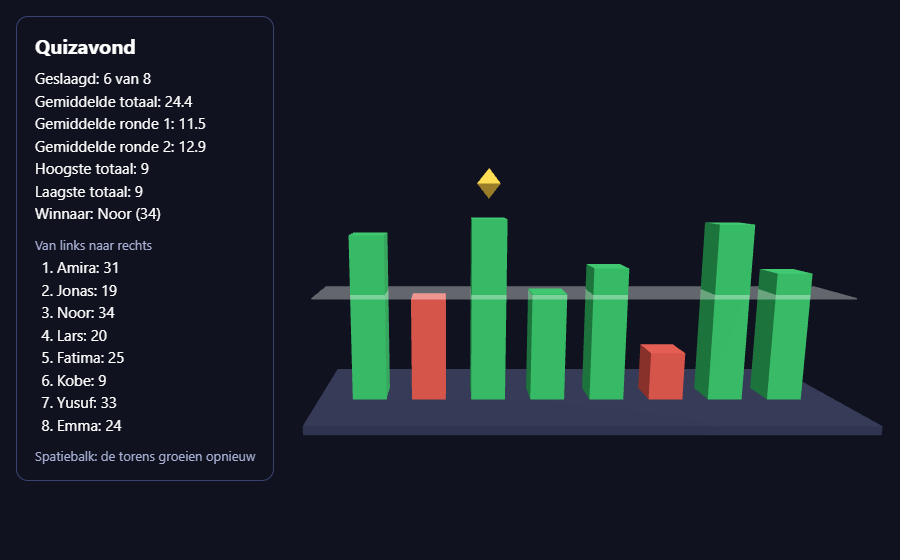
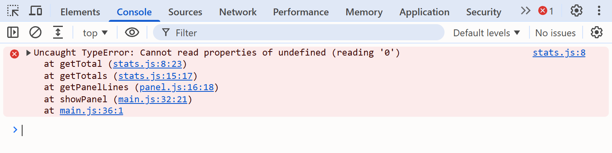
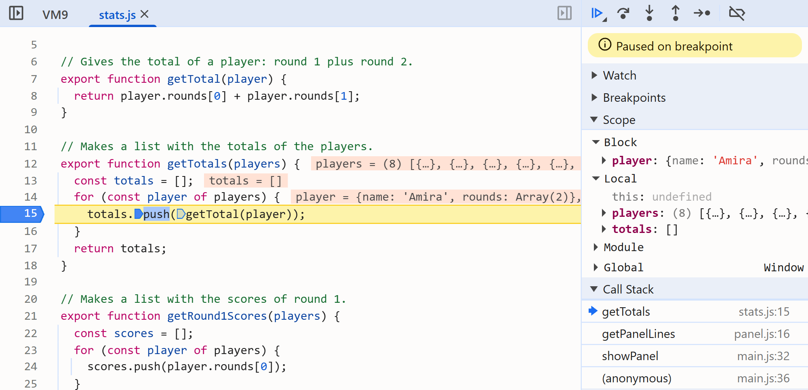
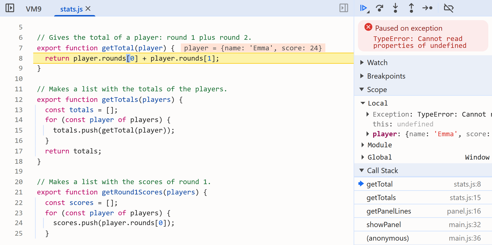
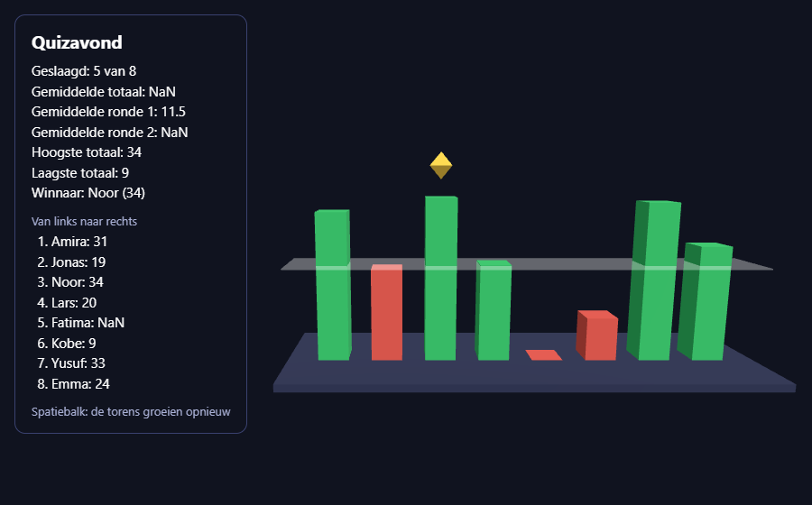
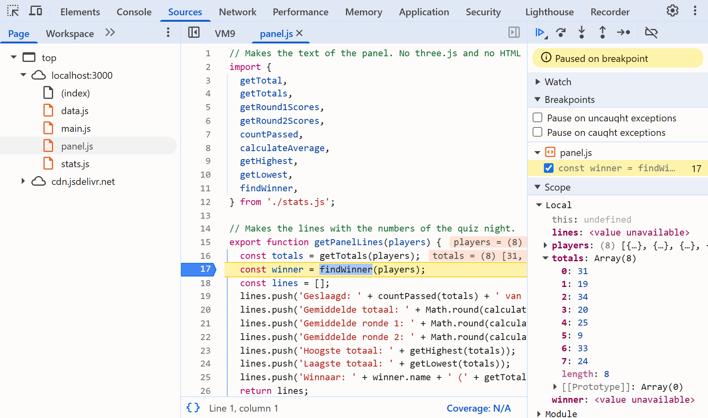

# Module 5: Debuggen en refactoren met AI

In module 4 nam je een project over: het 3D-scorebord. Je leerde het kennen, je liet het reviewen en je loste er één fout in op. Het project werkte toen.

In deze module gaat het project stuk. Je collega bouwde er snel een tweede ronde bij. Sindsdien crasht de pagina soms, klopt er een cijfer niet en staat er `NaN` in het paneel. Een fout in code heet ook een **bug**, en fouten opsporen en oplossen heet **debuggen**. Je leert het op een vaste manier doen: je leest de foutmelding, je zorgt dat je de fout elke keer opnieuw kan laten optreden, en je test één mogelijke oorzaak per keer. Daarna verbeter je de structuur van de code zonder dat ze iets anders gaat doen. Tot slot schrijf je tests die waarschuwen als er later toch iets stukgaat.

Een agent is bij elke stap een sterke hulp. Hij leest een foutmelding snel, stelt mogelijke oorzaken voor, vindt zwakke plekken in code en voert tests zelf uit. Hoe goed dat werkt, hangt af van wat jij hem geeft, en van wat jij daarna controleert.

### Leerdoelen

Na deze module kan je:

- een foutmelding lezen: het type, de boodschap en de plaats;
- een stack trace lezen, en het verschil zien tussen de plaats van een fout en de oorzaak;
- uitleggen wat een debugger en een breakpoint doen, en wanneer je ze gebruikt;
- zeggen welke foutmeldingen een agent zelf kan lezen, en welke jij hem geeft;
- een fout reproduceren, en ze verkleinen tot een minimal example;
- hypothesen over de oorzaak van een fout opstellen en ze één voor één testen, met een agent als hulp;
- code smells herkennen, en beslissen welke je aanpakt;
- code refactoren in kleine stappen, met een controle na elke stap;
- uitleggen wat een unit test, een integration test en een regression test zijn, en een regression test schrijven voor een fout die je oploste;
- een agent laten werken met tests, en controleren wat hij deed.

## 5.1 Foutmeldingen en stack traces lezen

Het scorebord uit module 4 heeft een versie 2. De quiz heeft nu twee rondes, en de toren van een speler toont het totaal van die twee rondes.

{width=560}

Je kaart uit [4.1](./module-4.md#4_1) helpt je nog altijd. Dit is er veranderd:

| Bestand | Taak | Nieuw in versie 2 |
| --- | --- | --- |
| `data.js` | de scores van de spelers | elke speler heeft een lijst `rounds` met twee scores |
| `stats.js` | de berekeningen | het totaal van een speler, het gemiddelde per ronde, het hoogste en het laagste totaal |
| `panel.js` | de tekst van het paneel | een nieuw bestand. Het gebruikt `stats.js` |
| `main.js` | de 3D-scène | zet de tekst van `panel.js` op de pagina |

Er zijn ook hulpbestanden. `server.js` ken je al. `check.js` toont de tekst van het paneel in de terminal. `repro.js` gebruik je in [5.2](#5_2), en `test.js` in [5.6](#5_6).

Een speler ziet er in `data.js` nu zo uit:

```js
{ name: 'Amira', rounds: [14, 17] },
```

En deze function in `stats.js` telt de twee rondes op:

```js
export function getTotal(player) {
  return player.rounds[0] + player.rounds[1];
}
```

### De pagina crasht

De organisator van de quiz verbetert na de avond een score. Hij kent alleen versie 1, en schrijft de regel van Emma in `data.js` zoals vroeger:

```js
{ name: 'Emma', score: 24 },
```

Je herlaadt de pagina. In het paneel staan geen cijfers en geen namen meer, en er zijn geen torens. In de console van je browser (zie [3.3](./module-3.md#3_3)) staat dit, in het rood:

```output
Uncaught TypeError: Cannot read properties of undefined (reading '0')
    at getTotal (stats.js:8:23)
    at getTotals (stats.js:15:17)
    at getPanelLines (panel.js:16:18)
    at showPanel (main.js:32:21)
    at main.js:36:1
```

{width=720}

Dat is veel tekst, en ze is in het Engels. Toch staat hier bijna alles wat je nodig hebt. Lees een foutmelding altijd in dezelfde volgorde.

### Een foutmelding heeft drie delen

1. Het **type**: `TypeError`. Het zegt welke soort fout het is.
2. De **boodschap**: `Cannot read properties of undefined (reading '0')`. Ze zegt wat er misliep.
3. De **plaats**: `stats.js:8:23`. Dat is het bestand, de regel en de kolom: regel 8 van `stats.js`, het 23e teken.

Deze drie types zie je het vaakst:

| Type | Wat het zegt | Voorbeeld van een boodschap |
| --- | --- | --- |
| `SyntaxError` | De code is niet geldig geschreven, bijvoorbeeld door een haakje te weinig. Het programma start niet. | `missing ) after argument list` |
| `ReferenceError` | De code gebruikt een naam die niet bestaat, vaak door een tikfout. | `totaal is not defined` |
| `TypeError` | Een waarde is van een andere soort dan de code verwacht. | `Cannot read properties of undefined` |

Nu de boodschap. `Cannot read properties of undefined (reading '0')` betekent: de code wil plaats `0` lezen van iets, en dat iets is `undefined`. Op regel 8 van `stats.js` staat `player.rounds[0]`. De waarde `player.rounds` is dus `undefined`: deze speler heeft geen lijst `rounds`.

### De stack trace: wie riep wie aan?

De regels die met `at` beginnen, zijn samen de **stack trace**: de lijst van de functions die bezig waren op het moment van de fout, met bij elke function het bestand en de regel.

Je leest een stack trace van boven naar onder. Bovenaan staat waar de fout optrad. Elke regel eronder zegt wie de function van de regel erboven aanriep:

| Regel in de stack trace | Wat je leest |
| --- | --- |
| `at getTotal (stats.js:8:23)` | Hier trad de fout op: in `getTotal`, op regel 8 van `stats.js`. |
| `at getTotals (stats.js:15:17)` | `getTotals` riep `getTotal` aan, op regel 15. |
| `at getPanelLines (panel.js:16:18)` | `getPanelLines` in `panel.js` riep `getTotals` aan. |
| `at showPanel (main.js:32:21)` | `showPanel` in `main.js` riep `getPanelLines` aan. |
| `at main.js:36:1` | Regel 36 van `main.js` riep `showPanel` aan. Er staat geen naam van een function, want die regel staat niet in een function. |

In de console van je browser kan je op de naam van een bestand klikken, zoals `stats.js:8:23`. De browser opent dan dat bestand en toont de regel.

In de terminal krijg je dezelfde melding. Typ `node check.js`:

```output
Aantal spelers: 8
file:///C:/les/scorebord2/stats.js:8
  return player.rounds[0] + player.rounds[1];
                      ^

TypeError: Cannot read properties of undefined (reading '0')
    at getTotal (file:///C:/les/scorebord2/stats.js:8:23)
    at getTotals (file:///C:/les/scorebord2/stats.js:15:17)
    at getPanelLines (file:///C:/les/scorebord2/panel.js:16:18)
    at file:///C:/les/scorebord2/check.js:7:20
    at ModuleJob.run (node:internal/modules/esm/module_job:377:25)
    at async onImport.tracePromise.__proto__ (node:internal/modules/esm/loader:691:26)
    at async asyncRunEntryPointWithESMLoader (node:internal/modules/run_main:101:5)

Node.js v25.0.0
```

Node.js toont eerst de regel code, met een `^` onder de plaats van de fout. Daarna volgen hetzelfde type, dezelfde boodschap en bijna dezelfde stack trace. De paden van de bestanden zijn er langer: bij jou staat er het pad van jouw map. Onderaan staan regels met `node:internal`. Dat is code van Node.js zelf. Sla die regels over. Hetzelfde geldt voor regels uit een library, zoals `three.module.js`: zoek de eerste regel die uit een bestand van jou komt.

### De plaats is niet altijd de oorzaak

De fout trad op in `getTotal`, op regel 8. Is die regel fout? Nee. Voor zeven spelers werkt ze. De function kreeg voor de achtste speler iets wat ze niet verwachtte: een speler zonder `rounds`.

Volg de waarde daarom terug, langs de stack trace. `getTotal` kreeg de speler van `getTotals`. `getTotals` kreeg de lijst van `getPanelLines`, en die kreeg ze van `showPanel`: het is de lijst `players` uit `data.js`. Daar staat de regel van Emma, met `score` in plaats van `rounds`.

De oorzaak zit dus in `data.js`, een bestand dat niet eens in de stack trace staat. De stack trace toont de weg naar de fout. De oorzaak ligt vaak eerder op die weg. Stel bij elke regel van de stack trace dezelfde vraag: is deze code fout, of kreeg ze iets fouts?

Waarom zijn ook de torens weg? De fout zit toch in de tekst van het paneel? Na een fout stopt het script. Alles wat in `main.js` na regel 36 komt, wordt niet meer uitgevoerd: de scène, de torens en de animation loop. Een leeg scherm zegt je dus niet waar de fout zit. De console zegt het wel.

De oplossing is hier één regel in `data.js`: Emma krijgt opnieuw haar twee scores, `rounds: [9, 15]`.

### Als een foutmelding niet genoeg zegt

De crash van Emma is een duidelijke fout. Je krijgt een melding en een stack trace, en je vindt de oorzaak in een paar minuten. Niet elke fout is zo duidelijk. Deze vier gevallen zijn moeilijker:

| Wat er gebeurt | Waarom het moeilijker is |
| --- | --- |
| Er is geen foutmelding, maar het resultaat is fout. | Er is geen stack trace. Zulke fouten zoek je in [5.2](#5_2) en [5.3](#5_3). |
| Een waarde werd fout lang voor de crash, in een heel ander deel van het programma. | De stack trace toont alleen de weg naar de crash. Waar de waarde fout werd, staat er niet in. |
| De fout zit in code die later loopt: na een klik, na een timer of na een antwoord van een server. | De stack trace begint dan vaak bij dat stuk code. Wat eraan voorafging, staat er niet altijd in. |
| De fout treedt niet elke keer op. | Soms hangt ze af van de input (zie [5.2](#5_2)). Soms hangt ze af van welk stuk code eerst klaar is. Dat heet een **race condition**. Zo'n fout kan je moeilijk reproduceren. |

Een race condition krijg je in JavaScript bij code die op iets wacht, bijvoorbeeld op een antwoord van een server. In talen zoals Java en C# kunnen stukken code ook tegelijk lopen. Zo'n stuk heet een **thread**, en ook tussen threads krijg je race conditions.

Bij zulke fouten wil je zien wat de code doet terwijl ze loopt. Dat kan op twee manieren: met `console.log` (zie [5.3](#5_3)) en met een debugger.

### De debugger: je code pauzeren

Een **debugger** is gereedschap waarmee je code laat pauzeren op een regel die jij kiest. Terwijl de code stilstaat, bekijk je de waarden van de variables op die plaats. Je hoeft daarvoor niets aan de code te veranderen.

Elke browser heeft een debugger. In Chrome en Edge open je hem zo: druk op F12 (op een Mac Cmd+Option+I) en kies bovenaan de tab **Sources**. Klik links op een bestand van het project, bijvoorbeeld `stats.js`. Je ziet de code, met regelnummers. Staat de debugger in het Nederlands, dan hebben de tab en de knoppen andere namen: Sources heet dan bijvoorbeeld Bronnen.

Een **breakpoint** (pauzepunt) is een markering op een regel code. Je zet een breakpoint met een klik op het regelnummer: het nummer wordt blauw. Herlaad daarna de pagina. De code pauzeert net voor ze die regel uitvoert. Klik je opnieuw op het regelnummer, dan is het breakpoint weer weg.

De twee afbeeldingen hieronder tonen het scorebord met de regel van Emma nog in de oude vorm.

{width=720}

Op de afbeelding staat een breakpoint op regel 15 van `stats.js`. Je ziet vier dingen:

1. De regel met de gele achtergrond. Daar staat de code stil. Die regel is nog niet uitgevoerd.
2. **Scope**: de waarden van de variables op dit moment. `player` is Amira, de eerste speler, en de lijst `totals` is nog leeg.
3. **Call Stack**: de functions die nu bezig zijn. Bovenaan staat de function waarin de code stilstaat: `getTotals`. Elke regel eronder zegt wie de function erboven aanriep. Het is dezelfde lijst als in een stack trace. Alleen is er nu geen fout: de code staat stil.
4. De knoppen, rechtsboven. Daarmee laat je de code verder lopen. Je gebruikt de eerste vier, van links naar rechts:

| Knop | Toets | Wat ze doet |
| --- | --- | --- |
| **Resume** | F8 | De code loopt verder, tot ze opnieuw op een breakpoint komt. |
| **Step over** | F10 | De regel wordt uitgevoerd, en de code pauzeert op de volgende regel. Roept de regel een function aan, dan wordt die function helemaal uitgevoerd. |
| **Step into** | F11 | De debugger gaat de function binnen die de regel aanroept, en pauzeert op de eerste regel van die function. |
| **Step out** | Shift+F11 | De rest van de function waarin je zit, wordt uitgevoerd. De code pauzeert op de plaats waar die function aangeroepen werd. |

Werken de toetsen niet op je Mac? Klik dan op de knoppen.

Je kan de debugger ook zelf de plaats van een crash laten zoeken. Haal eerst je breakpoint weg. Klik rechts op **Breakpoints** als dat deel dicht is. Vink de optie **Pause on uncaught exceptions** aan, en herlaad de pagina. Een exception is een fout die het programma laat stoppen. Uncaught betekent dat geen code ze opving. Bij de crash van Emma zie je dan dit:

{width=720}

De code staat stil op regel 8, de regel uit de foutmelding. Naast regel 7 toont de debugger de waarde van `player`: `{name: 'Emma', score: 24}`. Deze speler heeft geen `rounds`. Onder **Call Stack** staan de vijf regels van de stack trace. Een foutmelding zegt waar de code stopte. Een debugger toont ook welke waarden de variables op dat moment hadden. Vink de optie weer uit als je klaar bent, en klik op **Resume**.

Ook Visual Studio Code heeft een debugger, met bijna dezelfde knoppen. Resume heet er **Continue**, met de toets F5. Je gebruikt hem voor code die in Node.js loopt, zoals `node check.js`. Klik in Visual Studio Code net links van een regelnummer: er komt een rode stip, en dat is je breakpoint. Druk daarna op Ctrl+Shift+P (op een Mac Cmd+Shift+P), typ `JavaScript Debug Terminal` en kies het commando **Debug: JavaScript Debug Terminal**. Er opent een terminal. Typ daar je commando. De code pauzeert op je breakpoint.

Je hebt de debugger in de core-reeks niet nodig. Wil je er zelf mee werken? Maak dan extra oefening [X14](./module-5-oefeningen.md#x14).

### Een foutmelding aan een agent geven

Een foutmelding met een stack trace is sterke context voor een model (zie [1.4](./module-1.md#1_4)). Het type, de plaats en de weg naar de fout staan erin. Een agent vindt met zo'n melding vaak snel waar hij moet kijken.

Geef daarom altijd de volledige melding, met de stack trace, en niet alleen de eerste regel. Kopieer en plak ze (zie [3.3](./module-3.md#3_3)). Zeg er ook bij wat je het laatst veranderde: dat is vaak de beste aanwijzing.

Ken je de oorzaak nog niet, vraag dan eerst uitleg, zonder wijziging:

```text
Verander niets aan de code. Ik paste de regel van Emma aan in data.js.
Sindsdien is de pagina leeg, en in de console staat:

Uncaught TypeError: Cannot read properties of undefined (reading '0')
    at getTotal (stats.js:8:23)
    at getTotals (stats.js:15:17)
    at getPanelLines (panel.js:16:18)
    at showPanel (main.js:32:21)
    at main.js:36:1

Leg in eenvoudige woorden uit wat deze melding zegt. Waar treedt de fout
op, en waar kan de oorzaak zitten?
```

Controleer het antwoord met wat je zelf las. Bestaan de bestanden en de regels die het model noemt? Zegt het antwoord waar de fout optreedt, en ook waar de oorzaak zit?

### Wat een agent zelf kan lezen

Een agent ziet je scherm niet. Het model leest alleen wat in zijn context komt (zie [1.4](./module-1.md#1_4)). Een foutmelding kan op drie plaatsen staan:

| Waar staat de melding? | Kan de agent ze lezen? |
| --- | --- |
| In de output van een commando dat de agent zelf uitvoerde | Ja. De agent harness geeft die output aan het model. |
| In een terminal waarin jij een commando typte | Reken er niet op. Plak de output in je prompt, of vraag de agent om het commando zelf uit te voeren. |
| In de console van je browser | Niet vanzelf. Kopieer de melding en plak ze in je prompt. |

Het scorebord start je met `node server.js`. Die server geeft alleen bestanden door aan je browser. De code van het scorebord wordt uitgevoerd in je browser. De melding van de crash staat dus in de console van je browser, en niet in de terminal van de server. Een agent die alleen die terminal leest, vindt geen fout.

Daarom zit `check.js` in het project. Het voert de berekeningen uit in Node.js, zonder browser. De fout treedt dan op in de terminal, en daar kan een agent ze zelf lezen:

```text
Verander niets aan de code. Voer node check.js uit en lees de
foutmelding. Leg in eenvoudige woorden uit wat ze zegt. Waar treedt de
fout op, en waar kan de oorzaak zitten?
```

Je hebt dus twee wegen: jij plakt de melding, of de agent voert het commando uit en leest ze zelf. Lees de melding in de twee gevallen ook zelf. Alleen zo kan je het antwoord controleren.

`check.js` gebruikt alleen `data.js`, `stats.js` en `panel.js`. Een fout in `index.html` of in `main.js` zie je er niet mee: die staat alleen in de console van je browser, en die melding kopieer je zelf. Sommige agent harnesses kunnen ook een browser besturen (zie [5.6](#5_6)).

Dit geldt ook voor andere projecten. Veel projecten start je met één commando, bijvoorbeeld `npm run dev`. Loopt dat commando zelf vast, dan staat de melding in de terminal. Loopt de code in de browser vast, dan staat de melding in de console van de browser.

::: info
**Tip voor later: error tracking.** Later draait je app bij echte gebruikers. Crasht ze daar, dan staat de foutmelding in de browser of op de gsm van die gebruiker. Jij ziet ze niet. Je hoort alleen: "Het werkt niet." Zonder melding en zonder stack trace is zo'n fout moeilijk te reproduceren.

Daarom bouwen teams **error tracking** in hun app. Je voegt een kleine library van een dienst toe aan je app. Die library vangt de fouten op die je code niet zelf afhandelt. Ze stuurt de foutmelding en de stack trace naar een dashboard, vaak met de browser en de versie van je app erbij. Treedt dezelfde fout op bij honderd gebruikers, dan zie je ze daar als één regel met een teller. Bekende diensten zijn Sentry en Rollbar, en voor mobiele apps Firebase Crashlytics.

Een stack trace van een echte gebruiker is ook sterke context voor een agent. Let wel op wat je app doorstuurt: zo'n melding kan persoonsgegevens bevatten, bijvoorbeeld in het adres van een pagina. Module 7 gaat over privacy.
:::

### De melding weg is niet de fout weg

Je kan ook meteen vragen: "Los deze fout op." Kijk dan goed waar de oplossing komt. Een oplossing op de plaats van de fout kan er zo uitzien:

```js
export function getTotal(player) {
  if (player.rounds === undefined) {
    return 0;
  }
  return player.rounds[0] + player.rounds[1];
}
```

De melding uit `getTotal` is nu weg. Typ je `node check.js`, dan krijg je een nieuwe:

```output
TypeError: Cannot read properties of undefined (reading '0')
    at getRound1Scores (stats.js:27:30)
    at getPanelLines (panel.js:21:67)
    at check.js:7:20
```

We tonen hier alleen de melding en de regels van het project, met korte paden.

Dezelfde fout, op een andere plaats: nu loopt `getRound1Scores` vast op de speler zonder `rounds`. De oorzaak zit er nog, want de regel van Emma is niet veranderd.

Je kan op elke plaats zo'n controle toevoegen. Dan verdwijnen alle meldingen. Emma heeft dan 0 punten, een rode toren zonder hoogte, en het gemiddelde van de avond is te laag. Niets waarschuwt je nog. Een foutmelding is informatie. Een oplossing die alleen de melding weghaalt, maakt van een fout met een melding een fout zonder melding. Die tweede soort is veel moeilijker te vinden (zie [3.5](./module-3.md#3_5)).

Zo'n controle is niet altijd verkeerd. Is de afspraak dat een speler zonder scores 0 punten krijgt, dan is ze juist. Maar dat is een regel van de quiz, en die beslis jij met de organisator (zie [1.6](./module-1.md#1_6)). Zeg in je prompt dus waar de oorzaak zit, of vraag ernaar voor je iets laat veranderen.

Dit betekent voor jou: lees bij elke foutmelding het type, de boodschap en de plaats. Vraag je daarna af: is deze regel fout, of kreeg ze iets fouts?

### Test jezelf 5.1 – Foutmeldingen en stack traces {#test-jezelf-5-1-foutmeldingen-en-stack-traces}

```text
Sectie: 5.1
Type: meerkeuze
Vraag: Wat is een stack trace? Kies één antwoord.
Opties:
  A. Een lijst van alle variables en hun waarden op het moment van een fout.
  B. De lijst van de functions die bezig waren op het moment van een fout, met bij elke function het bestand en de regel.
  C. Een overzicht van alle fouten die ooit in het programma optraden.
  D. De regel code die de oorzaak van de fout is.
Juist: B
Feedback A: Een stack trace toont geen waarden van variables. Die meet je zelf, bijvoorbeeld met `console.log` (zie 5.3).
Feedback B: Juist. Bovenaan staat waar de fout optrad, en elke regel eronder zegt wie de function erboven aanriep (zie 5.1).
Feedback C: Een stack trace hoort bij één fout, op één moment (zie 5.1).
Feedback D: Een stack trace toont de weg naar de fout. De oorzaak zoek je op die weg, en ze staat er niet altijd in (zie 5.1).

Sectie: 5.1
Type: koppelen
Vraag: Koppel elk type foutmelding aan wat het zegt.
Paren:
  SyntaxError → De code is niet geldig geschreven. Het programma start niet.
  ReferenceError → De code gebruikt een naam die niet bestaat.
  TypeError → Een waarde is van een andere soort dan de code verwacht.
Feedback: Het type is het eerste wat je leest. Het zegt in welke richting je moet zoeken (zie 5.1).

Sectie: 5.1
Type: meerkeuze
Vraag: In de console staat deze melding. In welke function trad de fout op? Kies één antwoord.
Code:
  Uncaught TypeError: Cannot read properties of undefined (reading 'name')
      at getWinnerLine (panel.js:12:30)
      at showPanel (main.js:33:3)
      at main.js:36:1
Opties:
  A. In getWinnerLine.
  B. In showPanel.
  C. In main.js, op regel 36.
  D. Dat kan je uit deze melding niet weten.
Juist: A
Feedback A: Juist. De bovenste regel van de stack trace toont waar de fout optrad (zie 5.1).
Feedback B: `showPanel` riep `getWinnerLine` aan. De fout trad op in de function van de bovenste regel (zie 5.1).
Feedback C: Dat is de onderste regel: daar begon de weg. De fout trad op in de function van de bovenste regel (zie 5.1).
Feedback D: De stack trace zegt het wel: lees de bovenste regel (zie 5.1).

Sectie: 5.1
Type: meerkeuze
Vraag: Een function werkt voor zeven spelers. Bij de achtste speler geeft ze een TypeError. Waar zoek je de oorzaak eerst? Kies één antwoord.
Opties:
  A. In de function zelf: de regel uit de foutmelding is altijd de fout.
  B. In Node.js: de regels met `node:internal` tonen waar het misloopt.
  C. In wat de function kreeg: de data van de achtste speler, en de code die de function aanriep.
  D. In de browser: een andere browser geeft de fout misschien niet.
Juist: C
Feedback A: De regel werkt voor zeven spelers. De plaats van de fout is niet altijd de oorzaak (zie 5.1).
Feedback B: Dat is code van Node.js zelf. Die regels sla je over (zie 5.1).
Feedback C: Juist. Vraag je af: is deze code fout, of kreeg ze iets fouts? Volg de waarde terug langs de stack trace (zie 5.1).
Feedback D: De fout zit in het project, niet in de browser. Elke browser loopt op dezelfde plaats vast (zie 5.1).

Sectie: 5.1
Type: meerkeuze
Vraag: Je pagina is leeg. Welke prompt helpt je het best op weg? Kies één antwoord.
Opties:
  A. De pagina werkt niet meer. Los het op.
  B. Er staat een TypeError in de console. Wat is er fout?
  C. Verander niets aan de code. Ik paste data.js aan, en sindsdien is de pagina leeg. In de console staat deze melding: (de volledige melding met de stack trace). Leg uit wat ze zegt, en waar de oorzaak kan zitten.
  D. Herschrijf main.js zodat er geen fouten meer in zitten.
Juist: C
Feedback A: Het model weet niet wat je ziet. Het moet raden, en het verandert meteen je code (zie 5.1).
Feedback B: Het type alleen is te weinig. De boodschap, de plaats en de stack trace ontbreken (zie 5.1).
Feedback C: Juist. Je geeft de volledige melding, je zegt wat je het laatst veranderde, en je vraagt eerst uitleg (zie 5.1).
Feedback D: De fout hoeft niet in `main.js` te zitten. Een leeg scherm zegt niet waar de oorzaak zit (zie 5.1).

Sectie: 5.1
Type: meerkeuze
Vraag: Een agent lost een TypeError op met een controle: is de waarde undefined, dan geeft de function 0 terug. De melding is weg. Wat is je oordeel? Kies één antwoord.
Opties:
  A. In orde: zonder foutmelding is er geen fout meer.
  B. Je weet het nog niet. De melding is weg, maar de oorzaak misschien niet. Je zoekt uit waarom de waarde undefined was, en of 0 hier het juiste resultaat is.
  C. Fout: een function mag nooit controleren of een waarde undefined is.
  D. In orde: een agent kiest altijd de kleinste wijziging.
Juist: B
Feedback A: De fout kan nu zonder melding verder leven, met een fout cijfer als gevolg (zie 5.1).
Feedback B: Juist. Een foutmelding is informatie. Haal ze pas weg als je de oorzaak kent (zie 5.1).
Feedback C: Zo'n controle kan juist zijn, als ze een afspraak van het project uitvoert. Dat beslis jij (zie 5.1).
Feedback D: Een kleine wijziging is niet vanzelf de juiste. Controleer waar ze komt en wat ze doet (zie 5.1).

Sectie: 5.1
Type: meerkeuze
Vraag: De pagina van het scorebord is leeg. De server draait in je terminal. Je vraagt een agent: "Lees de terminal van de server en zeg wat er fout is." De agent vindt geen foutmelding. Hoe komt dat? Kies één antwoord.
Opties:
  A. De code van de pagina wordt uitgevoerd in de browser. De melding staat in de console van de browser, en die leest de agent niet.
  B. Een agent kan nooit output uit een terminal lezen.
  C. Er is geen fout: zonder melding in de terminal werkt de pagina.
  D. De server verbergt foutmeldingen voor een agent.
Juist: A
Feedback A: Juist. Plak de melding uit de console in je prompt, of laat de agent `node check.js` uitvoeren: dan treedt de fout op in de terminal (zie 5.1).
Feedback B: Een agent leest de output van commando's die hij zelf uitvoert. Hier staat de melding op een andere plaats: in de console van de browser (zie 5.1).
Feedback C: De pagina is leeg, dus er is iets fout. De melding staat in de console van de browser (zie 5.1).
Feedback D: De server geeft alleen bestanden door. De fout treedt op in de browser, en daar staat ook de melding (zie 5.1).

Sectie: 5.1
Type: koppelen
Vraag: Je code staat stil op een breakpoint. Koppel elke knop van de debugger aan wat ze doet.
Paren:
  Resume → De code loopt verder, tot het volgende breakpoint.
  Step over → De regel wordt uitgevoerd. De code pauzeert op de volgende regel.
  Step into → De debugger gaat de function binnen die de regel aanroept.
  Step out → De rest van de function wordt uitgevoerd. De code pauzeert waar die function aangeroepen werd.
Feedback: Met een breakpoint pauzeer je de code op een regel. Met deze vier knoppen laat je ze verder lopen, in één keer of stap per stap (zie 5.1).

Sectie: 5.1
Type: meerkeuze
Vraag: Je code staat stil op een breakpoint. Wat toont het deel Scope van de debugger? Kies één antwoord.
Opties:
  A. De waarden van de variables op dit moment.
  B. Alle foutmeldingen van de pagina.
  C. De regels code die al uitgevoerd zijn.
  D. De bestanden van het project.
Juist: A
Feedback A: Juist. Je ziet de waarden zonder dat je een regel `console.log` toevoegt (zie 5.1).
Feedback B: Foutmeldingen staan in de console. Scope toont de waarden van de variables (zie 5.1).
Feedback C: De regel waar de code stilstaat, heeft een gele achtergrond. Scope toont de waarden van de variables (zie 5.1).
Feedback D: De bestanden staan links in de tab Sources. Scope toont de waarden van de variables (zie 5.1).

Sectie: 5.1
Type: juist/fout
Vraag: Na een fout in een script voert de browser de rest van dat script gewoon uit.
Juist: fout
Feedback: Na een fout stopt het script. Alles wat erna komt, wordt niet uitgevoerd. Daarom kan een fout in de tekst van het paneel ook de torens laten verdwijnen (zie 5.1).
```

## 5.2 Een fout reproduceren: het minimal example

Emma heeft weer twee scores, en de pagina werkt. Kijk nu kritisch naar het paneel in de afbeelding van [5.1](#5_1). Er staat: "Hoogste totaal: 9". Maar Noor haalde 34 punten, en haar toren is de hoogste.

Er is geen foutmelding. De pagina werkt, maar ze klopt niet (zie [4.6](./module-4.md#4_6)).

### Eerst reproduceren

Voor je een oorzaak zoekt, zorg je dat je de fout kan **reproduceren**: je laat ze op commando optreden. Dezelfde stappen en dezelfde input geven elke keer dezelfde fout.

Dat heeft twee redenen:

- Je kan zoeken. Elke test die je doet, geeft een antwoord waarop je kan vertrouwen.
- Je kan bewijzen dat de fout weg is. Kan je een fout niet laten optreden, en blijft ze na je wijziging weg? Dan weet je niet of dat door je wijziging komt.

Voor het scorebord is reproduceren eenvoudig. `check.js` toont de tekst van het paneel in de terminal, zonder browser:

```bash
node check.js
```

```output
Aantal spelers: 8
Geslaagd: 6 van 8
Gemiddelde totaal: 24.4
Gemiddelde ronde 1: 11.5
Gemiddelde ronde 2: 12.9
Hoogste totaal: 9
Laagste totaal: 9
Winnaar: Noor (34)
```

De fout staat er ook. Dat leert je al iets: ze zit niet in de browser en niet in de 3D-scène. Ze zit in de berekeningen of in de tekst van het paneel. En je kan ze nu laten optreden met één commando.

Je collega antwoordt: "Bij mij klopte het." Hij testte met de scores van een andere avond, en toen was het hoogste totaal juist. Dezelfde code, andere data, een ander resultaat. De fout hangt dus af van de input. Je zoekt nu welke input ze laat optreden.

### Maak het kleiner

Een **minimal example** is het kleinste stuk code dat de fout nog toont. Je laat stap voor stap weg wat niet nodig is. Na elke stap kijk je of de fout er nog is.

**Stap 1: van het project naar één function.** In `panel.js` staat `'Hoogste totaal: ' + getHighest(totals)`. Het cijfer komt dus van `getHighest` in `stats.js`. Roep alleen die function aan, in `repro.js`, met de acht totalen van de avond:

```js
import { getHighest } from './stats.js';

console.log(getHighest([31, 19, 34, 20, 25, 9, 33, 24]));
```

```output
9
```

De fout is er nog. De browser, `panel.js` en `data.js` heb je niet meer nodig.

**Stap 2: maak de input kleiner.** Halveer de lijst, en kijk in welke helft de fout zit:

| Aanroep | Resultaat | Is de fout er nog? |
| --- | --- | --- |
| `getHighest([31, 19, 34, 20])` | `34` | nee |
| `getHighest([25, 9, 33, 24])` | `9` | ja |
| `getHighest([25, 9])` | `9` | ja |
| `getHighest([25])` | `25` | nee |

Twee getallen volstaan: 25 en 9.

**Stap 3: van de function naar één regel.** Lees nu de function:

```js
export function getHighest(totals) {
  const sorted = totals.sort();
  return sorted[sorted.length - 1];
}
```

Ze sorteert de lijst, en geeft het laatste getal terug. Test het sorteren apart:

```js
console.log([25, 9].sort());
```

```output
[ 25, 9 ]
```

Eén regel, zonder project. `sort()` zet 9 na 25. Dat is je minimal example.

### Wat je wint met een minimal example

- Je ziet de fout zonder de code eromheen.
- Je kan ze delen met een collega of met een model, zonder je hele project. Voor een model is het kleine, precieze context (zie [1.4](./module-1.md#1_4)): het hoeft niet te zoeken, en het kan zich niet vergissen in een ander deel van je code.
- Je hebt meteen een controle voor later. Na de oplossing moet `getHighest([25, 9])` het getal 25 geven. In [5.6](#5_6) maak je daar een test van.

### Vraag uitleg met je minimal example

```text
Verander niets aan de code. Deze regel toont [ 25, 9 ]:

console.log([25, 9].sort());

Verwacht: [ 9, 25 ]. Leg in eenvoudige woorden uit waarom sort() dit doet.
```

Het model antwoordt bijvoorbeeld: `sort()` zonder argument vergelijkt de waarden als tekst, niet als getallen. Als tekst komt "25" voor "9", omdat het teken "2" voor het teken "9" komt. In een woordenboek komt "ab" om dezelfde reden voor "b".

Dat is een bewering, en die test je (zie [3.2](./module-3.md#3_2)). Voorspel: als de uitleg klopt, dan blijft `[100, 25, 9]` in deze volgorde staan, want als tekst komt "1" voor "2" en "2" voor "9".

```js
console.log([100, 25, 9].sort());
```

```output
[ 100, 25, 9 ]
```

De voorspelling klopt. Nu begrijp je ook waarom je collega niets zag. Getallen van twee cijfers staan als tekst in dezelfde volgorde als getallen. Pas met een totaal onder 10 gaat het mis.

Een agent kan ook zelf verkleinen. Hij heeft een terminal (zie [1.3](./module-1.md#1_3)), dus hij kan een klein bestand schrijven en uitvoeren. Vraag bijvoorbeeld: "Schrijf in repro.js het kleinste voorbeeld dat deze fout toont, en voer het uit." Voer dat voorbeeld daarna zelf uit. Toont het dezelfde fout als de fout die jij zag? Een voorbeeld dat een andere fout toont, helpt je niet.

### De oplossing

Er zijn meerdere oplossingen. Twee ervan: `sort` een regel meegeven die getallen vergelijkt, of het hoogste getal zoeken met een loop. Je kiest met je criteria uit [4.5](./module-4.md#4_5). De loop kan iedereen in het team lezen. En `sort` verandert de lijst zelf, terwijl de afspraken in `AGENTS.md` zeggen dat een function in `stats.js` haar input niet verandert.

```js
export function getHighest(totals) {
  if (totals.length === 0) {
    return null;
  }
  let highest = totals[0];
  for (const total of totals) {
    if (total > highest) {
      highest = total;
    }
  }
  return highest;
}
```

Controleer met je minimal example: `getHighest([25, 9])` geeft nu `25`. En `node check.js` toont "Hoogste totaal: 34".

Dit betekent voor jou: kan je een fout tonen in een paar regels, dan is het zoeken bijna gedaan. Dat geldt voor jou, en ook voor een agent die je helpt.

### Test jezelf 5.2 – Een fout reproduceren {#test-jezelf-5-2-een-bug-reproduceren}

```text
Sectie: 5.2
Type: meerkeuze
Vraag: Waarom reproduceer je een fout voor je een oplossing zoekt? Kies één antwoord.
Opties:
  A. Omdat een model anders weigert om te helpen.
  B. Omdat je anders niet kan controleren of je oplossing werkt: de fout kan ook toevallig wegblijven.
  C. Omdat de code daar sneller van wordt.
  D. Omdat een fout na drie keer optreden vanzelf verdwijnt.
Juist: B
Feedback A: Een model helpt ook zonder reproductie. Alleen kan je zijn voorstel dan niet testen (zie 5.2).
Feedback B: Juist. Kan je de fout op commando laten optreden, dan kan je ook tonen dat ze weg is (zie 5.2).
Feedback C: Reproduceren heeft niets met snelheid te maken (zie 5.2).
Feedback D: Een fout verdwijnt niet vanzelf. Ze treedt op bij een bepaalde input (zie 5.2).

Sectie: 5.2
Type: meerkeuze
Vraag: Wat is een minimal example? Kies één antwoord.
Opties:
  A. Het kleinste stuk code dat de fout nog toont.
  B. Een kleine versie van het project waarin de fout opgelost is.
  C. De kortste prompt waarmee een agent de fout kan oplossen.
  D. De eerste regel van de foutmelding.
Juist: A
Feedback A: Juist. Je laat weg wat niet nodig is, tot alleen de fout overblijft (zie 5.2).
Feedback B: Een minimal example moet de fout net nog wel tonen (zie 5.2).
Feedback C: Het gaat om code, niet om de lengte van je prompt. Je kan het voorbeeld wel in je prompt zetten (zie 5.2).
Feedback D: Dat is een deel van de foutmelding. Een minimal example is code die je kan uitvoeren (zie 5.2).

Sectie: 5.2
Type: meerkeuze
Vraag: Wat toont deze code? Kies één antwoord.
Code:
  console.log([10, 9, 1].sort());
Opties:
  A. [ 1, 9, 10 ]
  B. [ 10, 9, 1 ]
  C. [ 1, 10, 9 ]
  D. Een foutmelding
Juist: C
Feedback A: Dat zou je verwachten, maar `sort()` zonder argument vergelijkt de waarden als tekst (zie 5.2).
Feedback B: De lijst wordt wel gesorteerd, alleen als tekst (zie 5.2).
Feedback C: Juist. Als tekst komt "1" eerst, dan "10" en dan "9", zoals "ab" voor "b" komt (zie 5.2).
Feedback D: `sort()` zonder argument is geldige code. Het resultaat is alleen niet wat je verwacht (zie 5.2).

Sectie: 5.2
Type: numeriek
Vraag: Je verkleint de input van een function die een fout toont. Met [25, 9, 33, 24] is de fout er. Met [25, 9] is de fout er. Met [25] is de fout er niet, en met [9] ook niet. Hoeveel getallen heeft de kleinste lijst die de fout nog toont?
Juist: 2
Feedback: Met twee getallen is de fout er nog, met één getal niet meer. De lijst [25, 9] is dus de kleinste input voor je minimal example (zie 5.2).

Sectie: 5.2
Type: ordenen
Vraag: Zet de stappen in de juiste volgorde: van een fout in een project naar een minimal example.
Volgorde:
  Laat de fout optreden met één commando.
  Roep alleen de function aan die het foute resultaat geeft, in een klein bestand.
  Maak de input kleiner, en kijk na elke stap of de fout er nog is.
  Stop bij het kleinste voorbeeld dat de fout nog toont.
Feedback: Eerst reproduceren, dan verkleinen. Na elke stap controleer je of de fout er nog is (zie 5.2).

Sectie: 5.2
Type: meerkeuze
Vraag: Met de scores van vorige week klopt het paneel. Met de scores van vanavond staat er een fout cijfer. De code is niet veranderd. Wat leid je daaruit af? Kies één antwoord.
Opties:
  A. De fout hangt af van de input. Je zoekt welke score van vanavond ze laat optreden.
  B. De browser is stuk. Je installeert hem opnieuw.
  C. Er is geen fout in de code: ze werkte vorige week.
  D. De fout komt en gaat toevallig. Je kan ze niet onderzoeken.
Juist: A
Feedback A: Juist. Dezelfde code met andere data geeft een ander resultaat. Het verschil in de data wijst de weg (zie 5.2).
Feedback B: De code en de browser zijn dezelfde als vorige week. Alleen de data is anders (zie 5.2).
Feedback C: Code kan voor de ene input werken en voor de andere niet. "Bij mij werkte het" is geen bewijs (zie 5.2).
Feedback D: De fout is niet toevallig: met dezelfde input treedt ze elke keer op (zie 5.2).

Sectie: 5.2
Type: meerkeuze
Vraag: Een agent schreef voor jou een minimal example. Wat doe je ermee? Kies één antwoord.
Opties:
  A. Je gebruikt het meteen als bewijs: een agent voerde het al uit.
  B. Je voert het zelf uit, en je kijkt of het dezelfde fout toont als de fout die jij zag.
  C. Je vraagt de agent of het voorbeeld klopt.
  D. Je gebruikt het niet: een minimal example moet je altijd zelf schrijven.
Juist: B
Feedback A: "Uitgevoerd" in het antwoord van een agent is een bewering. Voer het zelf uit (zie 1.7).
Feedback B: Juist. Een voorbeeld dat een andere fout toont, helpt je niet (zie 5.2).
Feedback C: Een model geeft je vaak gelijk. Dat is geen controle (zie 1.5).
Feedback D: Een agent kan goed helpen bij het verkleinen. Je controleert wel het resultaat (zie 5.2).
```

## 5.3 Debuggen met hypothesen

Een week later is Fatima ziek tijdens ronde 2. De organisator vult alleen haar score van ronde 1 in:

```js
{ name: 'Fatima', rounds: [12] },
```

{width=560}

In de console staat geen foutmelding. Toch kloppen er vier dingen niet:

- In het paneel staat "Gemiddelde totaal: NaN".
- In het paneel staat "Gemiddelde ronde 2: NaN".
- In de lijst van de spelers staat "Fatima: NaN".
- De toren van Fatima is plat.

`NaN` betekent not a number: het resultaat van een berekening die geen getal kan geven (zie [4.2](./module-4.md#4_2)).

### Gokken of testen

Je kan op twee manieren debuggen.

Bij **trial and error** verander je iets en kijk je of de fout weg is. Lukt het niet, dan verander je iets anders. Soms verdwijnt de fout. Je weet dan niet waarom, en ook niet of ze terugkomt.

Bij debuggen met hypothesen zoek je eerst de oorzaak. Een **hypothese** is een mogelijke oorzaak die je kan testen. Je werkt in vier stappen:

1. Observeer. Wat zie je precies? Noteer alles wat niet klopt.
2. Formuleer een hypothese: "Ik denk dat de oorzaak dit is."
3. Voorspel en test: "Als dat klopt, dan zie ik dit als ik dat meet." Meet één ding.
4. Besluit. Klopt de hypothese, of niet? In de twee gevallen weet je meer dan daarvoor.

Dat is "voorspel, verander en kijk" uit [3.2](./module-3.md#3_2), nu toegepast op een fout.

### console.log als meetinstrument

Je eenvoudigste meetinstrument is `console.log`. Zet het op de plaats waar je hypothese over gaat, en toon één waarde. In het scorebord doe je dat in `panel.js`, in de function `getPanelLines`. Met `node check.js` zie je het resultaat in de terminal.

Waarom `console.log`, en niet de debugger uit [5.1](#5_1)? Met `node check.js` komt de output van `console.log` als tekst in de terminal. Je kan ze kopiëren en in een prompt plakken, en een agent die het commando zelf uitvoert, kan ze lezen. Een agent die een fout zoekt, werkt vaak op dezelfde manier: hij voegt een `console.log` toe, voert de code uit en leest de output. Een debugger toont dezelfde waarden op je scherm. Daar leest een agent ze niet vanzelf.

**Hypothese 1: `calculateAverage` rekent fout.** Het woord "Gemiddelde" staat in de twee foute regels van het paneel. Voorspelling: ook voor een eenvoudige lijst geeft de function een fout resultaat.

```js
console.log(calculateAverage([10, 20]));
```

```output
15
```

De hypothese klopt niet: de function rekent juist. Ze kreeg dus iets fouts. En de hypothese verklaarde ook niet waarom er "Fatima: NaN" staat, want die regel gebruikt `calculateAverage` niet. Een goede hypothese verklaart alles wat je ziet.

**Hypothese 2: het totaal van Fatima is `NaN`.** Voorspelling: in de lijst `totals` staat op de vijfde plaats `NaN`, en de andere totalen zijn gewone getallen.

```js
console.log(totals);
```

```output
[
   31, 19, 34, 20,
  NaN,  9, 33, 24
]
```

De hypothese klopt. Een som waarin `NaN` zit, is zelf `NaN`: daarom is het gemiddelde totaal `NaN`. En een toren met hoogte `NaN` groeit niet.

**Hypothese 3: `getTotal` telt een score op die niet bestaat.** Voorspelling: de lijst `rounds` van Fatima heeft maar één score. Je kijkt in `data.js`: `rounds: [12]`. De function rekent dus `12 + undefined`, en dat geeft `NaN`. Ook "Gemiddelde ronde 2" is nu verklaard: voor Fatima bestaat die score niet.

| Hypothese | Meting | Resultaat | Besluit |
| --- | --- | --- | --- |
| `calculateAverage` rekent fout | `calculateAverage([10, 20])` | `15` | klopt niet |
| Het totaal van Fatima is `NaN` | `totals` | `NaN` op de vijfde plaats | klopt |
| `getTotal` telt een score op die niet bestaat | `rounds` van Fatima in `data.js` | `[12]` | klopt: dit is de oorzaak |

Eén oorzaak, vier gevolgen. De score die ontbreekt, komt in twee berekeningen terecht, en je ziet het resultaat op vier plaatsen. Zoek dus waar een foute waarde ontstaat, niet waar je ze ziet. De oorzaak is een aanname (zie [4.2](./module-4.md#4_2)): de code neemt aan dat elke speler twee scores heeft.

Ben je klaar met meten? Haal je regels met `console.log` dan weer weg.

::: info
**Meten met een breakpoint.** Je kan ook meten met de debugger uit [5.1](#5_1). Zet een breakpoint op regel 17 van `panel.js` en herlaad de pagina. De code pauzeert, en onder **Scope** staat de lijst `totals`. Je hoeft geen regel `console.log` toe te voegen of weg te halen.

{width=720}

Een breakpoint is handig als je veel waarden tegelijk wil zien, of als je regel per regel wil volgen wat de code doet. Wil je het proberen? Maak dan extra oefening [X14](./module-5-oefeningen.md#x14).
:::

### Een agent als denkpartner

Een model is sterk in het bedenken van mogelijke oorzaken: veel fouten lijken op fouten uit zijn training data. Een agent kan ook snel de bestanden van je project lezen. Vraag daarom eerst naar oorzaken en naar een test, en nog niet naar een oplossing:

```text
Verander niets aan de code. Sinds ik de regel van Fatima aanpaste in
data.js, staat in het paneel "Gemiddelde totaal: NaN" en "Fatima: NaN".
Verwacht: getallen. De console toont geen foutmelding.
Geef drie mogelijke oorzaken. Zeg bij elke oorzaak hoe ik ze test met
één console.log.
```

Zo krijg je hypothesen die je zelf kan testen. Je mag de agent ook zelf laten meten: hij kan `node check.js` uitvoeren en de output lezen. Vraag dan dat hij zijn stappen toont: welke hypothese, welke meting en welk resultaat. Zo kan je volgen wat hij deed, en het controleren.

### Eerst de oorzaak, dan één wijziging

Je kan ook meteen "Los het op" sturen, terwijl je de oorzaak nog niet kent. Dan kunnen er drie dingen misgaan:

- **Te veel wijzigingen tegelijk.** De agent verandert meerdere dingen, en de fout verdwijnt. Je weet dan niet welke wijziging hielp. Misschien is er ook code veranderd die goed was (zie [1.5](./module-1.md#1_5)).
- **Het model kiest een regel die jij moet kiezen.** Hoeveel punten krijgt een speler voor een gemiste ronde? 0 punten? Of telt de speler niet mee voor het gemiddelde? Dat staat niet in de code. Het is een regel van de quiz. Zeg je ze niet in je prompt, dan kiest het model er een (zie [2.1](./module-2.md#2_1)).
- **Blijven proberen in hetzelfde gesprek.** De eerste oplossing werkt niet. Je stuurt "Het werkt nog niet", en daarna nog eens. Lukt het na twee pogingen niet, begin dan een nieuw gesprek en zeg wat je nu weet (zie [3.3](./module-3.md#3_3)).

Zoek dus eerst de oorzaak, met één hypothese per keer. Vraag daarna één wijziging, en zeg erbij welke regel geldt. Voor het scorebord beslist de organisator: een gemiste ronde telt als 0 punten. Je zet die regel in `README.md`.

### Controleer alles wat niet klopte

Stel dat de oplossing in `getTotal` komt: de function telt voortaan alle scores op die in `rounds` staan. Typ `node check.js`:

```output
Aantal spelers: 8
Geslaagd: 5 van 8
Gemiddelde totaal: 22.8
Gemiddelde ronde 1: 11.5
Gemiddelde ronde 2: NaN
Hoogste totaal: 34
Laagste totaal: 9
Winnaar: Noor (34)
```

Het gemiddelde totaal is weer een getal. Maar "Gemiddelde ronde 2" is nog altijd `NaN`: een andere function leest de score van ronde 2 ook. Wie alleen naar het eerste cijfer kijkt, denkt dat het klaar is.

Loop na een oplossing daarom je hele lijst van stap 1 af. Hier is de eenvoudigste oplossing één regel in `data.js`: `rounds: [12, 0]`. Daarna zijn de vier gevolgen weg:

```output
Aantal spelers: 8
Geslaagd: 5 van 8
Gemiddelde totaal: 22.8
Gemiddelde ronde 1: 11.5
Gemiddelde ronde 2: 11.3
Hoogste totaal: 34
Laagste totaal: 9
Winnaar: Noor (34)
```

Dit betekent voor jou: kan je de oorzaak van een fout in één zin zeggen, dan kan je ook een goede oplossing vragen en ze controleren.

### Test jezelf 5.3 – Debuggen met hypothesen {#test-jezelf-5-3-hypothesegedreven-debuggen}

```text
Sectie: 5.3
Type: meerkeuze
Vraag: Wat is het verschil tussen trial and error en debuggen met hypothesen? Kies één antwoord.
Opties:
  A. Trial and error gebruik je voor kleine fouten, hypothesen voor grote.
  B. Bij debuggen met hypothesen test je gericht één mogelijke oorzaak. Bij trial and error verander je dingen tot de fout weg is.
  C. Bij trial and error gebruik je een agent, bij hypothesen niet.
  D. Er is geen verschil: in de twee gevallen is de fout op het einde weg.
Juist: B
Feedback A: Het verschil zit in de aanpak, niet in de grootte van de fout (zie 5.3).
Feedback B: Juist. Na elke test weet je meer, ook als de hypothese niet klopt (zie 5.3).
Feedback C: Je kan de twee manieren met en zonder agent gebruiken. Een agent kan je net helpen om hypothesen te bedenken (zie 5.3).
Feedback D: Bij trial and error weet je niet waarom de fout verdween, en dus ook niet of ze terugkomt (zie 5.3).

Sectie: 5.3
Type: ordenen
Vraag: Zet de stappen van debuggen met hypothesen in de juiste volgorde.
Volgorde:
  Observeer: noteer alles wat niet klopt.
  Formuleer een hypothese over de oorzaak.
  Voorspel wat je zal meten, en meet één ding.
  Besluit: klopt de hypothese of niet?
Feedback: Je meet pas als je weet wat je verwacht. Het resultaat bepaalt je volgende hypothese (zie 5.3).

Sectie: 5.3
Type: meerkeuze
Vraag: Wat toont deze code? Kies één antwoord.
Code:
  const rounds = [12];
  console.log(rounds[0] + rounds[1]);
Opties:
  A. 12
  B. 0
  C. NaN
  D. Een foutmelding
Juist: C
Feedback A: `rounds[1]` bestaat niet, en dat is `undefined`, niet 0 (zie 5.3).
Feedback B: Het eerste getal is 12, en er wordt iets bij opgeteld dat geen getal is (zie 5.3).
Feedback C: Juist. `rounds[1]` is `undefined`, en `12 + undefined` geeft `NaN` (zie 5.3).
Feedback D: Een plaats lezen die niet bestaat in een lijst, geeft `undefined` en geen foutmelding. Daarom valt deze fout niet op (zie 5.3).

Sectie: 5.3
Type: meerkeuze
Vraag: Je test een hypothese, en ze klopt niet. Wat heb je daaraan? Kies één antwoord.
Opties:
  A. Niets: de tijd is verloren.
  B. Je weet nu dat je de code moet laten herschrijven.
  C. Je weet waar de oorzaak niet zit, en je volgende hypothese is gerichter.
  D. Je weet dat de fout niet op te lossen is.
Juist: C
Feedback A: Ook een hypothese die niet klopt, leert je iets. Dat is het verschil met gokken (zie 5.3).
Feedback B: Herschrijven zonder de oorzaak te kennen is trial and error (zie 5.3).
Feedback C: Juist. In 5.3 leerde de eerste test dat `calculateAverage` juist rekent. De oorzaak zat dus in wat ze kreeg (zie 5.3).
Feedback D: Eén hypothese die niet klopt, zegt niets over de andere mogelijke oorzaken (zie 5.3).

Sectie: 5.3
Type: meerkeuze
Vraag: Een model geeft drie mogelijke oorzaken voor een fout. De eerste klinkt het meest logisch. Wat doe je? Kies één antwoord.
Opties:
  A. Je laat de eerste oorzaak meteen oplossen: het model zet de beste vooraan.
  B. Je laat de drie oorzaken tegelijk oplossen, zodat de fout zeker weg is.
  C. Je stuurt de vraag opnieuw tot het model maar één oorzaak geeft.
  D. Je kiest de oorzaak die het best verklaart wat je ziet, en je test ze met één meting.
Juist: D
Feedback A: De volgorde van een antwoord is geen bewijs. Een oplossing zonder test is een gok (zie 5.3).
Feedback B: Dan weet je niet welke wijziging hielp, en je verandert misschien code die goed was (zie 5.3).
Feedback C: Zo test je niets. Een meting beslist welke oorzaak klopt (zie 5.3).
Feedback D: Juist. Het model levert de hypothesen, een meting beslist (zie 5.3).

Sectie: 5.3
Type: meerkeuze
Vraag: In het paneel staat NaN omdat een speler een ronde miste. Je stuurt: "Los de NaN op." Welk risico loop je? Kies één antwoord.
Opties:
  A. Het model kiest zelf hoeveel punten een gemiste ronde waard is, en dat is een regel van de quiz.
  B. Het model kan geen NaN oplossen.
  C. Het model verwijdert de speler uit data.js.
  D. Er is geen risico: NaN heeft maar één mogelijke oplossing.
Juist: A
Feedback A: Juist. Wat je niet zegt, kiest het model. Beslis de regel eerst, en zet ze in je prompt (zie 5.3).
Feedback B: Een model kan dat wel. De vraag is welke oplossing het kiest (zie 5.3).
Feedback C: Dat kan, maar het is één van veel mogelijke keuzes. Het punt is dat jij de keuze niet maakte (zie 5.3).
Feedback D: Er zijn meerdere oplossingen: 0 punten, de speler niet meetellen, of een melding tonen (zie 5.3).

Sectie: 5.3
Type: juist/fout
Vraag: Als het eerste foute cijfer na je oplossing weer klopt, is de fout volledig opgelost.
Juist: fout
Feedback: Eén oorzaak kan meerdere gevolgen hebben. Loop na een oplossing alles af wat niet klopte. In 5.3 bleef "Gemiddelde ronde 2" na een eerste oplossing nog `NaN` (zie 5.3).
```

## 5.4 Code smells herkennen

De fouten uit 5.1 tot 5.3 zijn opgelost, en het scorebord werkt. Is de code dan goed? Werkende code is het minimum (zie [4.4](./module-4.md#4_4)). Kijk naar deze twee functions in `stats.js`:

```js
// Makes a list with the scores of round 1.
export function getRound1Scores(players) {
  const scores = [];
  for (const player of players) {
    scores.push(player.rounds[0]);
  }
  return scores;
}

// Makes a list with the scores of round 2.
export function getRound2Scores(players) {
  const scores = [];
  for (const player of players) {
    scores.push(player.rounds[1]);
  }
  return scores;
}
```

Ze werken allebei juist. Toch stoort er iets. De twee functions zijn gelijk, op één teken na. Komt er een ronde 3, dan komt er een derde kopie. Moet er iets veranderen, dan moet dat op twee plaatsen.

Dat is een **code smell**: een herkenbaar patroon in code dat wijst op een mogelijk probleem met de kwaliteit, terwijl de code juist werkt. Een code smell is geen fout. Het is een signaal: op deze plaats wordt de code moeilijk om te lezen of om aan te passen.

Deze code smells kom je vaak tegen:

| Code smell | Wat je ziet | Waarom het een probleem kan zijn |
| --- | --- | --- |
| **Duplication** (dubbele code) | dezelfde regels staan op meerdere plaatsen | een wijziging moet op elke plaats gebeuren, en je vergeet er snel één |
| **Magic number** | een getal zonder naam, midden in de code | je weet niet wat het betekent, en niet waar het nog staat |
| **Dead code** | code die nergens meer gebruikt wordt | wie de code leest, denkt dat ze nog meetelt |
| Onduidelijke namen | namen zoals `a`, `x`, `tmp` of `data` | je moet de hele function lezen om te weten wat iets is |
| Een lange function | één function die meerdere dingen doet | ze is moeilijk te begrijpen, te testen en aan te passen |
| Diep geneste conditions | een `if` in een `if` in een `if` | je ziet moeilijk welke code wanneer uitgevoerd wordt |
| Debugcode die bleef staan | een `console.log` van een vorige meting | de console staat vol, en je eigen metingen vallen niet meer op |

In het scorebord vind je er vijf:

- Duplication: de twee functions hierboven. En in `panel.js` staat drie keer dezelfde berekening om af te ronden: `Math.round(... * 10) / 10`.
- Magic number: de `10` in die berekening. Twee keer het getal 10 betekent hier: afronden op één cijfer na de komma. Dat staat er nergens bij.
- Dead code: de function `top` in `stats.js`. Ze komt uit versie 1, en geen enkel bestand roept ze nog aan. Ze leest zelfs `score`, een waarde die niet meer bestaat.
- Onduidelijke namen: `a` en `x` in die function `top`.
- Debugcode: `console.log('winner', winner);` in `main.js`.

Een code smell is vaak ook de plaats waar een fout ontstaat. Wie code kopieert, moet in elke kopie het juiste aanpassen. In [4.6](./module-4.md#4_6) zag je dat al: een regel van de quiz die op drie plaatsen stond, stond op één plaats fout.

### Niet elke code smell pak je aan

Een code smell wegwerken is zelf een wijziging, en elke wijziging kan iets stukmaken. Beslis daarom per smell, met de context van je project:

- Wordt deze code nog aangepast? Dubbele code in een deel dat elke week verandert, is dringender dan in een deel dat niemand nog aanraakt.
- Hindert de smell wie de code leest?
- Hoe groot is de wijziging om ze weg te werken, en kan je het resultaat controleren?

In `main.js` staat `+ 0.8` in de function `createDiamond`: de afstand tussen een toren en de diamant. Dat is een magic number. Het staat op één plaats, in code die werkt en die niemand moet aanpassen. Je mag het laten staan.

### Laat een agent code smells zoeken

Code smells zoeken is een vraag van de soort evalueren (zie [2.5](./module-2.md#2_5)). Zeg dat de agent niets mag veranderen, en vraag een vaste vorm (zie [4.3](./module-4.md#4_3)):

```text
Verander niets aan de code. Zoek code smells in stats.js en panel.js.
Geef er hoogstens vijf. Geef per code smell de regel, het soort smell en
in één zin waarom het hier een probleem is.
```

Een model doet dit goed. Dubbele code, een function die niemand aanroept of een getal zonder naam zijn patronen die in de code zelf staan. Wat niet in de code staat, weet het model niet: welk deel jullie volgende week aanpassen, wat het team leesbaar vindt en hoeveel tijd er is.

Beoordeel elke code smell daarom met de drie vragen uit [4.3](./module-4.md#4_3). Klopt het probleem? Zoek bijvoorbeeld zelf of `top` echt nergens gebruikt wordt. Past het voorstel in dit project? En wordt de code er beter van?

Dit betekent voor jou: een code smell is een signaal, geen opdracht. De agent vindt de signalen, en jij beslist welke je aanpakt.

### Test jezelf 5.4 – Code smells herkennen {#test-jezelf-5-4-code-smells-herkennen}

```text
Sectie: 5.4
Type: meerkeuze
Vraag: Wat is het verschil tussen een code smell en een fout? Kies één antwoord.
Opties:
  A. Een code smell geeft altijd een foutmelding, een fout niet.
  B. Een code smell is alleen belangrijk in grote projecten.
  C. Er is geen verschil: de twee woorden betekenen foute code.
  D. Code met een code smell kan juist werken. De smell wijst op een mogelijk probleem met de kwaliteit.
Juist: D
Feedback A: Code met een code smell werkt vaak zonder enige melding (zie 5.4).
Feedback B: Ook in een klein project maakt een code smell de code moeilijker om te lezen en aan te passen (zie 5.4).
Feedback C: Een fout geeft een fout resultaat. Code met een code smell kan het juiste resultaat geven (zie 5.4).
Feedback D: Juist. Een code smell is een signaal, geen fout (zie 5.4).

Sectie: 5.4
Type: categoriseren
Vraag: Bij welke code smell hoort elk voorbeeld?
Indeling:
  Twee functions zijn gelijk, op één teken na. → duplication
  Dezelfde berekening staat drie keer in één function. → duplication
  In een berekening staat het getal 0.21, zonder uitleg. → magic number
  Een function wordt door geen enkel bestand aangeroepen. → dead code
  Een variable heet x. → onduidelijke namen
Feedback: Je herkent een code smell aan het patroon, niet aan een foutmelding (zie 5.4).

Sectie: 5.4
Type: meerkeuze
Vraag: Een agent zegt: "De function top in stats.js is dead code." Hoe controleer je dat? Kies één antwoord.
Opties:
  A. Je zoekt in het hele project naar de naam van de function, en je kijkt of een bestand ze aanroept.
  B. Je verwijdert de function meteen: een agent las alle bestanden.
  C. Je vraagt de agent of hij zeker is.
  D. Je controleert het niet: dead code kan geen kwaad.
Juist: A
Feedback A: Juist. In Visual Studio Code zoek je in alle bestanden met Ctrl+Shift+F (zie 5.5).
Feedback B: Het is een bewering, en een bewering test je voor je iets verwijdert (zie 4.3).
Feedback C: Een model geeft je vaak gelijk, of blijft bij zijn antwoord. Dat is geen test (zie 1.5).
Feedback D: Dead code verwart wie de code leest. En verwijder je code die toch gebruikt wordt, dan crasht het project (zie 5.4).

Sectie: 5.4
Type: meerkeuze
Vraag: Welke code smell pak je het eerst aan? Kies één antwoord.
Opties:
  A. Een magic number in code die werkt en die niemand nog aanpast.
  B. Dubbele code in een deel van het project dat elke week verandert.
  C. Een lange function in een bestand dat volgende maand verdwijnt.
  D. Ze zijn allemaal even dringend.
Juist: B
Feedback A: Dat mag wachten. De smell hindert niemand, en elke wijziging kan iets stukmaken (zie 5.4).
Feedback B: Juist. Bij elke wijziging moet je daar op meerdere plaatsen zijn, en je vergeet er snel één (zie 5.4).
Feedback C: Code die verdwijnt, hoef je niet meer te verbeteren (zie 5.4).
Feedback D: De context bepaalt wat dringend is: wordt de code nog aangepast, en hindert de smell (zie 5.4).

Sectie: 5.4
Type: meerkeuze
Vraag: Je vraagt een agent om code smells te zoeken. Wat kan het model niet weten uit de code alleen? Kies één antwoord.
Opties:
  A. Of twee functions bijna gelijk zijn.
  B. Of een function door een ander bestand aangeroepen wordt.
  C. Welk deel van het project jullie de komende weken nog aanpassen.
  D. Of een getal een naam heeft.
Juist: C
Feedback A: Dat staat in de code. Een model ziet zulke patronen goed (zie 5.4).
Feedback B: Dat staat in de code, als de agent alle bestanden kan lezen (zie 5.4).
Feedback C: Juist. Plannen staan niet in de code. Daarom beslis jij welke code smell je aanpakt (zie 5.4).
Feedback D: Dat staat in de code (zie 5.4).

Sectie: 5.4
Type: juist/fout
Vraag: Elke code smell die een agent vindt, moet je meteen laten wegwerken.
Juist: fout
Feedback: Een code smell is een signaal, geen opdracht. Je beslist per smell, met de context van je project. Elke wijziging kan ook iets stukmaken (zie 5.4).
```

## 5.5 Refactoring: de structuur verbeteren, het gedrag behouden

Je beslist om de twee functions uit [5.4](#5_4) samen te voegen. Dat is **refactoring**: de structuur van code verbeteren zonder het gedrag te veranderen. Wie het programma gebruikt, merkt niets. Dezelfde input geeft dezelfde output. In [4.4](./module-4.md#4_4) deed je al een refactoring, toen de grens van 10 punten één plaats kreeg.

"Het gedrag blijft hetzelfde" is een belofte, en een belofte moet je kunnen controleren. Daarom werk je in drie stappen.

### 1. Leg het gedrag vast voor je begint

Typ `node check.js` en bewaar de output. Dat is het gedrag van voor de refactoring:

```output
Aantal spelers: 8
Geslaagd: 5 van 8
Gemiddelde totaal: 22.8
Gemiddelde ronde 1: 11.5
Gemiddelde ronde 2: 11.3
Hoogste totaal: 34
Laagste totaal: 9
Winnaar: Noor (34)
```

Bekijk ook de pagina. En bewaar een versie van je project, zodat je altijd terug kan (zie [3.1](./module-3.md#3_1)).

### 2. Zet één kleine stap

Een refactoring vragen is een vraag van de soort aanpassen (zie [2.5](./module-2.md#2_5)): zeg wat verandert, en wat hetzelfde blijft. Vraag één stap per prompt.

```text
In stats.js staan getRound1Scores en getRound2Scores. Ze doen hetzelfde,
voor een andere ronde. Maak één function getRoundScores(players,
roundNumber), met roundNumber 1 of 2. Gebruik ze in panel.js in plaats
van de twee oude functions. Verwijder de oude functions nog niet. Het
gedrag blijft precies hetzelfde. Verander niets anders.
```

De nieuwe function:

```js
// Makes a list with the scores of one round. roundNumber is 1 or 2.
export function getRoundScores(players, roundNumber) {
  const scores = [];
  for (const player of players) {
    scores.push(player.rounds[roundNumber - 1]);
  }
  return scores;
}
```

Let op `roundNumber - 1`: de score van ronde 1 staat op plaats 0 van de lijst.

De tweede stap is het verwijderen van de twee oude functions. Zoek eerst of geen enkel bestand ze nog gebruikt: druk in Visual Studio Code op Ctrl+Shift+F (op een Mac Cmd+Shift+F) en zoek naar `getRound1Scores`. Staan de oude namen nog in de `import` bovenaan in `panel.js`? Haal ze daar eerst weg: anders start het project niet meer. Verwijder daarna de twee functions, zelf of met een prompt.

Waarom twee stappen, en niet één? Loopt er na een stap iets mis, dan weet je welke stap de oorzaak is: de laatste (zie [3.3](./module-3.md#3_3)).

### 3. Controleer na elke stap

- Typ `node check.js`. Is de output regel per regel dezelfde als voor de refactoring?
- Bekijk de pagina. Ziet ze er hetzelfde uit, en werkt de spatiebalk nog?
- Welke bestanden veranderden? Veranderde er iets wat je niet vroeg (zie [1.5](./module-1.md#1_5))?
- Is de code beter, of alleen anders (zie [4.4](./module-4.md#4_4))?

Na de twee stappen is de output dezelfde als in stap 1. In `stats.js` staat nu één function waar er twee stonden, en een ronde 3 vraagt geen nieuwe kopie.

### Een fout oplossen en refactoren: nooit in dezelfde stap

Een refactoring verandert het gedrag niet. Een oplossing voor een fout verandert het gedrag net wel. Doe je de twee in één stap, en is de output daarna anders? Dan weet je niet of dat de bedoeling was, of een ongeluk.

Zie je tijdens een refactoring een fout? Noteer ze, werk je stap af en controleer. Los de fout daarna op in een eigen stap, met een eigen controle.

Dat heeft een gevolg dat vreemd lijkt: een refactoring behoudt ook het foute gedrag. Stond er voor de refactoring een fout cijfer in de output, dan staat het er daarna nog. Dat is juist.

### Waar je op let bij een agent

Refactoring is werk dat een agent goed kan. De opdracht is precies, en het resultaat kan je controleren: de output moet gelijk blijven. Drie dingen vragen je aandacht:

- Een te grote opdracht. Op "Ruim stats.js op" krijg je veel wijzigingen in één keer: namen, volgorde, nieuwe functions. Elke wijziging kan juist zijn. Samen kan je ze niet meer controleren. Zeg welke code smell je aanpakt, en in welke stap.
- Input die je controle niet bevat. `check.js` toont alleen het resultaat voor de scores van vanavond. Een function die herschreven is, kan zich anders gedragen bij een lege lijst of een waarde die ontbreekt (zie [2.6](./module-2.md#2_6)). Daarvoor dienen tests (zie [5.6](#5_6)).
- Een naam die andere bestanden gebruiken. Krijgt een function een nieuwe naam, dan moet elk bestand dat ze gebruikt mee veranderen.

Dit betekent voor jou: leg het gedrag vast, zet één stap en controleer. Dan pas zet je de volgende stap.

### Test jezelf 5.5 – Refactoring {#test-jezelf-5-5-refactoring}

```text
Sectie: 5.5
Type: meerkeuze
Vraag: Wat is refactoring? Kies één antwoord.
Opties:
  A. Code herschrijven om een nieuwe feature toe te voegen.
  B. De structuur van code verbeteren zonder het gedrag te veranderen.
  C. Een fout oplossen door de logica aan te passen.
  D. Code herschrijven zodat ze sneller uitgevoerd wordt.
Juist: B
Feedback A: Een nieuwe feature verandert het gedrag. Dat is geen refactoring (zie 5.5).
Feedback B: Juist. Dezelfde input geeft dezelfde output. Alleen de structuur is beter (zie 5.5).
Feedback C: Een fout oplossen verandert het gedrag. Doe dat in een aparte stap (zie 5.5).
Feedback D: Dat kan een gevolg zijn, maar het doel van een refactoring is een betere structuur (zie 5.5).

Sectie: 5.5
Type: ordenen
Vraag: Zet de stappen van een refactoring in de juiste volgorde.
Volgorde:
  Leg het gedrag vast: voer de controle uit en bewaar de output.
  Laat één kleine stap uitvoeren.
  Voer de controle opnieuw uit en vergelijk de output.
  Zet de volgende stap.
Feedback: Zonder de output van voor de refactoring kan je achteraf niets vergelijken (zie 5.5).

Sectie: 5.5
Type: meerkeuze
Vraag: Welke prompt is het best voor een refactoring? Kies één antwoord.
Opties:
  A. Ruim stats.js op.
  B. Maak de code beter en los ook de fouten op die je ziet.
  C. Maak in stats.js één function getRoundScores(players, roundNumber) in plaats van getRound1Scores en getRound2Scores. Gebruik ze in panel.js. Het gedrag blijft precies hetzelfde. Verander niets anders.
  D. Herschrijf het project in een modernere stijl.
Juist: C
Feedback A: De agent kiest dan zelf wat "opruimen" is, en je krijgt veel wijzigingen in één keer (zie 5.5).
Feedback B: Een refactoring en een oplossing voor een fout horen niet in dezelfde stap (zie 5.5).
Feedback C: Juist. Je zegt wat verandert, waar, en wat hetzelfde blijft (zie 5.5).
Feedback D: Dat is een grote opdracht zonder grens. Het resultaat kan je niet controleren (zie 5.5).

Sectie: 5.5
Type: numeriek
Vraag: In de lijst rounds staat de score van ronde 1 op plaats 0. Op welke plaats staat de score van ronde 2?
Juist: 1
Feedback: Een lijst begint te tellen bij 0. Ronde 2 staat dus op plaats 1. Daarom leest `getRoundScores` de plaats `roundNumber - 1` (zie 5.5).

Sectie: 5.5
Type: meerkeuze
Vraag: Tijdens een refactoring merkt een agent een fout in een berekening op. Hij stelt voor om die meteen mee op te lossen. Wat doe je? Kies één antwoord.
Opties:
  A. Je laat de twee samen doen: zo ben je sneller klaar.
  B. Je laat de fout staan: tijdens een refactoring mag je geen fouten oplossen, ook later niet.
  C. Je noteert de fout, je werkt de refactoring af en controleert. Daarna laat je de fout oplossen in een eigen stap.
  D. Je stopt met de refactoring en begint opnieuw.
Juist: C
Feedback A: Verandert de output daarna, dan weet je niet of dat door de oplossing komt of door de refactoring (zie 5.5).
Feedback B: De fout moet wel opgelost worden, alleen in een aparte stap (zie 5.5).
Feedback C: Juist. Een refactoring verandert het gedrag niet, een oplossing voor een fout wel. Hou ze uit elkaar (zie 5.5).
Feedback D: Dat is niet nodig. De refactoring en de fout zijn twee aparte stappen (zie 5.5).

Sectie: 5.5
Type: juist/fout
Vraag: Voor een refactoring stond er een fout cijfer in de output. Na een goede refactoring staat dat foute cijfer er nog.
Juist: juist
Feedback: Een refactoring verandert het gedrag niet, ook het foute gedrag niet. De fout los je op in een aparte stap (zie 5.5).

Sectie: 5.5
Type: meerkeuze
Vraag: Je liet een function herschrijven, en `node check.js` geeft dezelfde output als daarvoor. Wat weet je nu? Kies één antwoord.
Opties:
  A. De function gedraagt zich voor elke mogelijke input hetzelfde.
  B. De function geeft hetzelfde resultaat voor de data die check.js gebruikt. Over andere input, zoals een lege lijst, weet je nog niets.
  C. De code is leesbaarder geworden.
  D. Er zit geen enkele fout meer in het project.
Juist: B
Feedback A: `check.js` gebruikt alleen de scores van vanavond. Andere input controleerde je niet (zie 5.5).
Feedback B: Juist. Een controle bewijst alleen wat ze controleert. Voor andere input schrijf je tests (zie 5.6).
Feedback C: Dezelfde output zegt niets over de leesbaarheid. Dat beoordeel je apart (zie 4.4).
Feedback D: Een refactoring lost geen fouten op, en dezelfde output bewijst niet dat er geen fouten zijn (zie 5.5).
```

## 5.6 Regressions voorkomen met tests

Stel dat de agent in [5.5](#5_5) `player.rounds[roundNumber]` schreef, zonder `- 1`. Dat is een **off-by-one error**: een fout waarbij de code één plaats naast de juiste zit. `node check.js` toont dan:

```output
Aantal spelers: 8
Geslaagd: 5 van 8
Gemiddelde totaal: 22.8
Gemiddelde ronde 1: 11.3
Gemiddelde ronde 2: NaN
Hoogste totaal: 34
Laagste totaal: 9
Winnaar: Noor (34)
```

Zes van de acht regels zijn dezelfde als voor de wijziging. Vergelijk je de output snel, dan mis je de twee andere.

Dat is een **regression** (regressie): iets wat werkte, gaat stuk door een wijziging. Elke wijziging kan een regression veroorzaken: een oplossing voor een fout, een refactoring of een nieuwe feature. Vaak gebeurt het op een plaats waar je niet keek.

Twee dingen helpen tegen regressions. Met kleine stappen weet je welke stap de oorzaak is. Met tests merk je het meteen.

### Een test is code die code controleert

Met `check.js` vergelijk jij de output, met je ogen. Een **test** doet die vergelijking zelf. Een test roept code aan met een vaste input, vergelijkt het resultaat met de verwachte waarde, en zegt of het klopt.

Het scorebord heeft een bestand `test.js`. Twee tests daaruit:

```js
check('hasPassed: 20 is geslaagd', hasPassed(20), true);
check('calculateAverage van 10 en 20 is 15', calculateAverage([10, 20]), 15);
```

De function `check` staat bovenaan in `test.js`. Ze krijgt drie dingen: een naam voor de test, wat de code geeft, en wat je verwacht. Zijn die twee gelijk, dan toont ze `OK`. Anders toont ze `FOUT`, met de twee waarden.

Je voert alle tests uit met één commando:

```bash
node test.js
```

```output
OK    getTotal telt de twee rondes op
OK    getTotals geeft een totaal per speler
OK    hasPassed: 20 is geslaagd
OK    hasPassed: 19 is niet geslaagd
OK    countPassed telt de geslaagde totalen
OK    calculateAverage van 10 en 20 is 15
OK    calculateAverage van een lege lijst is null
OK    getHighest van 22, 35 en 13 is 35
OK    findWinner vindt de speler met het hoogste totaal
OK    paneel: het aantal geslaagde spelers
OK    paneel: het gemiddelde totaal
OK    paneel: het gemiddelde van ronde 1
OK    paneel: het gemiddelde van ronde 2
OK    paneel: het hoogste totaal
OK    paneel: het laagste totaal
OK    paneel: de winnaar

Alle tests zijn geslaagd.
```

De verwachte waarde haal je uit de regels van de quiz, niet uit de code. Volgens `README.md` is een speler geslaagd met minstens 20 punten: daarom verwacht de test `true` voor `hasPassed(20)`. Neem je de verwachte waarde over van wat de code nu geeft, dan test je alleen of de code zichzelf gelijk blijft. In module 6 ga je daar dieper op in.

De tests gebruiken ook niet `data.js`, maar een eigen lijst van drie spelers. De scores van een quizavond veranderen. De input van een test verandert niet.

### Drie soorten tests

| Soort | Wat ze test | Voorbeeld uit `test.js` |
| --- | --- | --- |
| **unit test** | één function, apart van de rest | `hasPassed(20)` geeft `true` |
| **integration test** | meerdere onderdelen die samenwerken | `getPanelLines` maakt met `stats.js` de juiste tekst voor drie spelers |
| **regression test** | een fout die al eens opgelost is | `getHighest([25, 9])` geeft `25` |

Een unit test zegt precies welke function fout is. Een integration test vindt fouten in de samenwerking: twee functions die elk juist zijn, maar verkeerd gecombineerd worden. Een regression test zorgt dat een oude fout niet ongemerkt terugkomt. Die naam zegt waarom de test bestaat, niet hoe groot ze is: een regression test is vaak ook een unit test.

Met de off-by-one error van hierboven toont `node test.js` onder meer dit:

```output
FOUT  paneel: het gemiddelde van ronde 1
      verwacht: Gemiddelde ronde 1: 12.3
      gekregen: Gemiddelde ronde 1: 11
FOUT  paneel: het gemiddelde van ronde 2
      verwacht: Gemiddelde ronde 2: 11
      gekregen: Gemiddelde ronde 2: NaN

Aantal tests met FOUT: 2
```

Je hoeft niets te vergelijken. De tests zeggen wat er fout is, en waar.

### Van minimal example naar regression test

Kijk nog eens naar de tests. Ze slaagden allemaal, ook toen `getHighest` de fout uit [5.2](#5_2) nog had. De test voor `getHighest` gebruikt de totalen 22, 35 en 13: alleen getallen van twee cijfers. Tests die slagen, bewijzen alleen wat ze testen.

Je minimal example uit [5.2](#5_2) is precies de test die ontbrak. Maak er een test van, bij de regression tests in `test.js`:

```js
check('getHighest: een totaal onder 10', getHighest([25, 9]), 25);
```

Met de oude `getHighest` toont `node test.js` onder meer:

```output
FOUT  getHighest: een totaal onder 10
      verwacht: 25
      gekregen: 9
```

Met de nieuwe `getHighest` staat er `OK`. Volg bij elke fout deze volgorde:

1. Schrijf een test die faalt door de fout.
2. Los de fout op.
3. Voer de tests uit. De nieuwe test slaagt, en de andere slagen nog altijd.
4. Laat de test staan. Zet iemand de fout later terug, dan zegt de test het.

Zie je een test eerst falen, dan weet je dat ze de fout kan zien. Een test die je nooit zag falen, test misschien niets.

### Een agent en tests

Een agent harness kan commando's uitvoeren in de terminal (zie [1.3](./module-1.md#1_3)). Met tests heeft een agent dus een manier om zijn eigen werk te controleren. Hij past de code aan, voert `node test.js` uit, leest wat er `FOUT` is en verbetert zijn wijziging. Zeg dat in je prompt:

```text
Los de fout in getHighest op: getHighest([25, 9]) moet 25 geven. Voer
daarna node test.js uit. Alle tests moeten slagen. Verander test.js
niet. Verander niets anders.
```

Dat werkt goed, want een test is een precieze opdracht met een resultaat dat je kan controleren (zie [2.6](./module-2.md#2_6)). Wil je dat de agent het altijd doet, zet de regel dan in `AGENTS.md` (zie [2.4](./module-2.md#2_4)): "Voer na elke wijziging `node test.js` uit."

Controleer achteraf drie dingen:

- Voer de tests zelf uit. "Alle tests slagen" in het antwoord van een agent is een bewering (zie [1.7](./module-1.md#1_7)).
- Is `test.js` nog dezelfde? Een test slaagt ook als iemand de verwachte waarde aanpast, of de test verwijdert. Daarom zeg je "Verander test.js niet", en kijk je welke bestanden de agent aanpaste.
- Lost de code het probleem op, of alleen de test? Een function die alleen voor `[25, 9]` het juiste getal geeft, laat de test ook slagen. Lees de nieuwe code, en test zelf een tweede input.

### Wat deze tests niet zien: de pagina

`test.js` roept functions aan in Node.js. Het opent geen browser. Een fout in `index.html`, een toren met de verkeerde kleur of een diamant boven de verkeerde toren ziet het niet. Daarvoor kijk je zelf, of je gebruikt een test die de pagina opent.

::: info
**Headless browser.** Een **headless browser** is een browser zonder venster. Code bestuurt hem, in plaats van een muis. Een test kan zo de echte pagina openen, lezen wat er in het paneel staat en een screenshot nemen.

Sommige agent harnesses kunnen op die manier ook zelf een browser besturen, vaak met een uitbreiding (plugin). De agent opent dan je pagina, leest de console en bekijkt het resultaat. Je hoeft dan geen foutmelding meer te kopiëren. De regels blijven dezelfde: jij zegt wat het verwachte gedrag is, en jij controleert het resultaat.
:::

Dit betekent voor jou: schrijf na elke fout die je oplost één regression test. Zo kan dezelfde fout niet ongemerkt terugkomen.

### Test jezelf 5.6 – Regressions voorkomen met tests {#test-jezelf-5-6-regressies-voorkomen}

```text
Sectie: 5.6
Type: meerkeuze
Vraag: Wat is een regression? Kies één antwoord.
Opties:
  A. Iets wat werkte, gaat stuk door een wijziging.
  B. Een fout in een feature die nog nooit werkte.
  C. Code die trager wordt.
  D. Een test die een fout resultaat verwacht.
Juist: A
Feedback A: Juist. Een oplossing voor een fout, een refactoring of een nieuwe feature kan een regression veroorzaken (zie 5.6).
Feedback B: Een regression gaat over iets wat al werkte (zie 5.6).
Feedback C: Trager is niet stuk. Een regression gaat over gedrag dat niet meer klopt (zie 5.6).
Feedback D: Dat is een fout in een test. Een regression is een fout in de code, door een wijziging (zie 5.6).

Sectie: 5.6
Type: koppelen
Vraag: Koppel elke soort test aan wat ze test.
Paren:
  unit test → één function, apart van de rest
  integration test → meerdere onderdelen die samenwerken
  regression test → een fout die al eens opgelost is
Feedback: Een unit test zegt welke function fout is, een integration test vindt fouten in de samenwerking, en een regression test bewaakt een oude fout (zie 5.6).

Sectie: 5.6
Type: meerkeuze
Vraag: Wat is de verwachte waarde in deze test? Kies één antwoord.
Code:
  check('calculateAverage van 10 en 20 is 15', calculateAverage([10, 20]), 15);
Opties:
  A. [10, 20]
  B. 15
  C. 'calculateAverage van 10 en 20 is 15'
  D. calculateAverage
Juist: B
Feedback A: Dat is de input van de function (zie 5.6).
Feedback B: Juist. De test vergelijkt wat de code geeft met 15, de waarde die je verwacht (zie 5.6).
Feedback C: Dat is de naam van de test. Ze staat in de output naast OK of FOUT (zie 5.6).
Feedback D: Dat is de function die getest wordt (zie 5.6).

Sectie: 5.6
Type: meerkeuze
Vraag: Alle tests van een project slagen. Wat weet je? Kies één antwoord.
Opties:
  A. Het project bevat geen fouten.
  B. De code is goed leesbaar.
  C. De code doet wat de tests controleren. Over input zonder test weet je niets.
  D. Je hoeft de pagina niet meer te bekijken.
Juist: C
Feedback A: In 5.6 slaagden alle tests terwijl `getHighest` fout was voor een totaal onder 10 (zie 5.6).
Feedback B: Tests zeggen niets over leesbaarheid (zie 4.4).
Feedback C: Juist. Tests die slagen, bewijzen alleen wat ze testen (zie 5.6).
Feedback D: Deze tests openen geen browser. Een fout op de pagina zien ze niet (zie 5.6).

Sectie: 5.6
Type: ordenen
Vraag: Je vond een fout en maakte een minimal example. Zet de volgende stappen in de juiste volgorde.
Volgorde:
  Schrijf een test die faalt door de fout.
  Los de fout op.
  Voer alle tests uit: de nieuwe test slaagt, en de andere slagen nog.
  Laat de test in het project staan.
Feedback: Zie je de test eerst falen, dan weet je dat ze de fout kan zien (zie 5.6).

Sectie: 5.6
Type: meerkeuze
Vraag: Een agent schrijft: "De fout is opgelost en alle tests slagen." Wat doe je? Kies één antwoord.
Opties:
  A. Niets: de agent voerde de tests zelf uit.
  B. Je voert de tests zelf uit, je kijkt of het testbestand niet veranderd is, en je leest de nieuwe code.
  C. Je vraagt de agent om de tests nog een keer uit te voeren.
  D. Je verwijdert de tests: ze zijn niet meer nodig.
Juist: B
Feedback A: Het is een bewering van de agent, en die controleer je (zie 1.7).
Feedback B: Juist. Een test slaagt ook als de test zelf aangepast is, of als de code alleen de input van de test juist behandelt (zie 5.6).
Feedback C: Dan krijg je dezelfde bewering opnieuw. Voer ze zelf uit (zie 5.6).
Feedback D: De tests blijven staan. Ze waarschuwen als een fout later terugkomt (zie 5.6).

Sectie: 5.6
Type: meerkeuze
Vraag: Een test faalt. Een agent laat ze slagen door de verwachte waarde in de test te veranderen. Wat is je oordeel? Kies één antwoord.
Opties:
  A. In orde: het doel was dat de tests slagen.
  B. Niet in orde, behalve als de verwachte waarde echt fout was volgens de regels van het project. Dat controleer je zelf.
  C. In orde: een agent weet beter wat de juiste waarde is.
  D. Niet in orde: een test mag nooit veranderen.
Juist: B
Feedback A: Het doel is code die klopt. Een test die aangepast is aan foute code, bewaakt niets meer (zie 5.6).
Feedback B: Juist. De verwachte waarde komt uit de regels van het project. Klopte ze, dan moet de code veranderen en niet de test (zie 5.6).
Feedback C: Het model kent alleen wat in zijn context staat. De regels van de quiz beslis jij (zie 1.6).
Feedback D: Een test kan zelf fout zijn, en dan pas je ze aan. Maar dat beslis jij, met de regels van het project (zie 5.6).

Sectie: 5.6
Type: juist/fout
Vraag: De tests in test.js openen de pagina in een browser en controleren de kleur van de torens.
Juist: fout
Feedback: `test.js` roept functions aan in Node.js. Wat alleen op de pagina te zien is, controleer je zelf, of met een test in een headless browser (zie 5.6).
```

## Samenvatting

Nieuwe termen:

- bug en debuggen: een fout in code, en het opsporen en oplossen van zulke fouten.
- type, boodschap en plaats: de drie delen van een foutmelding.
- stack trace: de lijst van de functions die bezig waren op het moment van een fout, met bij elke function het bestand en de regel.
- race condition: een fout die afhangt van welk stuk code eerst klaar is, en die daardoor niet elke keer optreedt.
- thread: een stuk code dat tegelijk met andere stukken code loopt, in talen zoals Java en C#.
- debugger en breakpoint: gereedschap waarmee je code laat pauzeren, en de markering op de regel waar ze pauzeert. Terwijl de code stilstaat, zie je onder Scope de waarden van de variables, en onder Call Stack de functions die bezig zijn.
- step over, step into en step out: de knoppen van een debugger waarmee je één regel uitvoert, een function binnengaat en een function weer uitloopt.
- error tracking: een dienst die de crashes van je app bij gebruikers verzamelt, met de foutmelding en de stack trace.
- reproduceren: een fout op commando laten optreden, elke keer met dezelfde stappen en dezelfde input.
- minimal example: het kleinste stuk code dat de fout nog toont.
- hypothese: een mogelijke oorzaak die je kan testen.
- trial and error: dingen veranderen tot de fout weg is, zonder de oorzaak te kennen.
- code smell: een patroon in code dat wijst op een mogelijk probleem met de kwaliteit, terwijl de code juist werkt.
- duplication, magic number en dead code: dubbele code, een getal zonder naam, en code die nergens meer gebruikt wordt.
- refactoring: de structuur van code verbeteren zonder het gedrag te veranderen.
- off-by-one error: een fout waarbij de code één plaats naast de juiste zit.
- regression: iets wat werkte, gaat stuk door een wijziging.
- test: code die andere code aanroept met een vaste input en het resultaat vergelijkt met de verwachte waarde.
- unit test, integration test en regression test: een test van één function, van onderdelen die samenwerken, en van een fout die al eens opgelost is.
- headless browser: een browser zonder venster, die door code bestuurd wordt.

Belangrijkste regels:

- Lees van een foutmelding het type, de boodschap en de plaats. Lees de stack trace van boven naar onder, en zoek de eerste regel uit je eigen bestanden.
- De plaats van een fout is niet altijd de oorzaak. Vraag je af: is deze code fout, of kreeg ze iets fouts?
- Zegt een foutmelding niet genoeg, bekijk dan wat de code doet terwijl ze loopt: met `console.log` of met een debugger.
- Geef een agent de volledige foutmelding, en zeg wat je het laatst veranderde. Vraag eerst uitleg.
- Een agent leest de output van commando's die hij zelf uitvoert. De console van je browser leest hij niet: plak die melding, of laat de fout optreden in de terminal.
- De melding weg is niet de fout weg. Kijk waar een oplossing komt, en of ze de oorzaak aanpakt.
- Reproduceer een fout voor je ze oplost, en verklein ze tot een minimal example.
- Test één hypothese per keer, met één meting. Zoek eerst de oorzaak, en vraag daarna één wijziging. Loop na een oplossing alles af wat niet klopte.
- Een code smell is een signaal, geen opdracht. Jij beslist welke je aanpakt.
- Refactor in kleine stappen: leg het gedrag vast, zet één stap en controleer. Los een fout nooit op in dezelfde stap als een refactoring.
- Schrijf na elke fout die je oplost een regression test. Zie ze eerst falen.
- Laat een agent de tests uitvoeren, en controleer zelf: de tests, het testbestand en de nieuwe code.

## Veelgemaakte fouten

- Alleen de eerste regel van een foutmelding lezen of doorgeven. De stack trace toont de weg naar de fout.
- De oorzaak zoeken op de regel uit de foutmelding. In 5.1 trad de fout op in `getTotal`, en zat de oorzaak in `data.js`.
- Denken dat een agent ziet wat jij ziet. De console van je browser en je scherm komen niet vanzelf in zijn context.
- Een foutmelding laten verdwijnen met een controle, zonder de oorzaak te kennen. De fout leeft dan verder zonder melding.
- "Het werkt niet, los het op" sturen zonder de fout te reproduceren. Je kan dan ook niet controleren of ze weg is.
- Het eerste voorstel van een model toepassen zonder het te testen. Dat is trial and error, alleen sneller.
- Stoppen zodra het eerste foute cijfer weer klopt. Eén oorzaak kan meerdere gevolgen hebben.
- Je regels met `console.log` laten staan. Ze worden debugcode die de console vult.
- Elke code smell laten wegwerken omdat een agent ze vond. Elke wijziging kan iets stukmaken.
- Een refactoring en een oplossing voor een fout in één prompt vragen. Verandert de output, dan weet je niet waarom.
- "Ruim de code op" vragen. Je krijgt veel wijzigingen in één keer, en je kan ze niet meer controleren.
- Denken dat het project juist is omdat alle tests slagen. Tests bewijzen alleen wat ze testen.
- Een agent geloven die schrijft dat alle tests slagen. Voer ze zelf uit, en kijk of het testbestand nog hetzelfde is.

::: oefening
[Oefeningen module 5](./module-5-oefeningen.md)
:::
